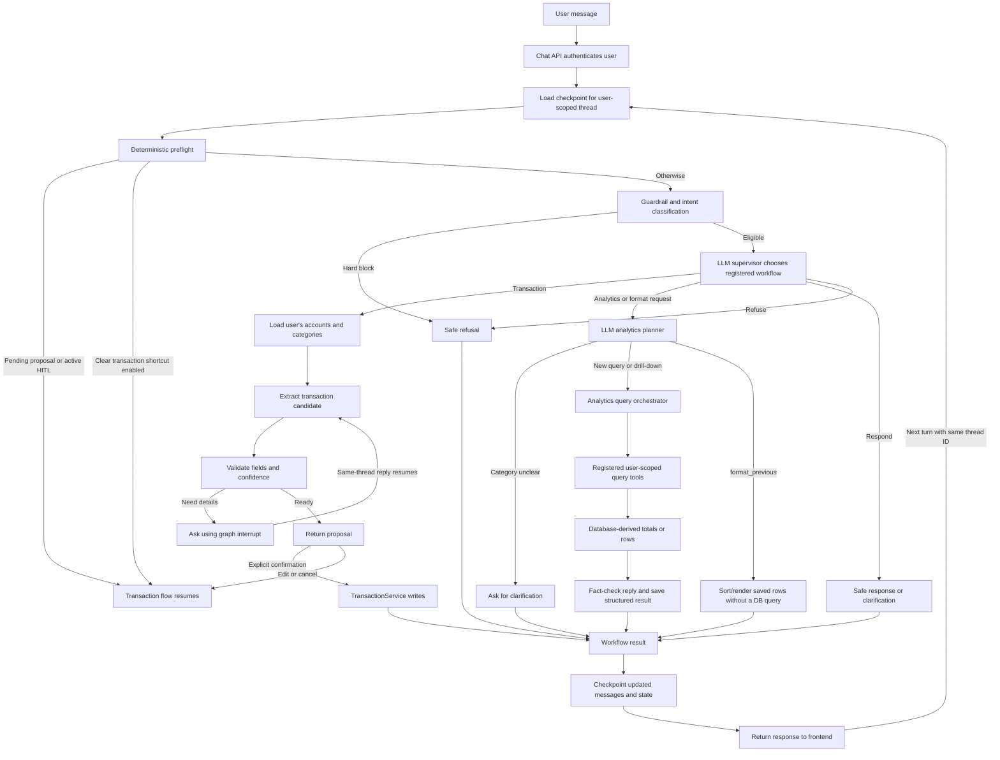
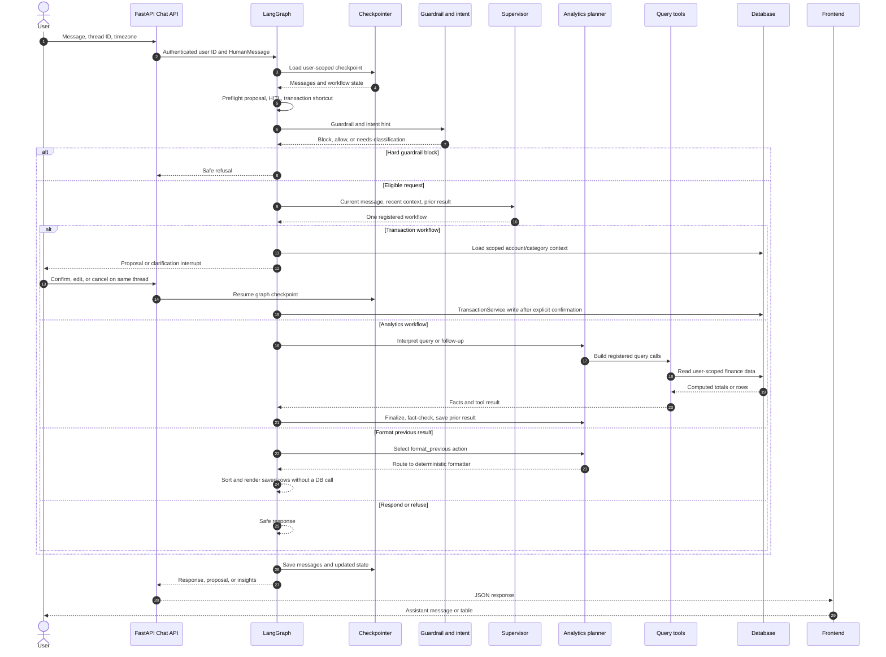

# AffordAbled LangGraph — A Practical Walkthrough

_Last updated: 2026-10-14_

This guide describes the **current implementation** of AffordAbled chat: what LangGraph is doing, what the supervisor decides, how transaction and analytics paths work, how state persists between HTTP requests, and what remains outside the current graph.

> **In one sentence:** LangGraph runs a typed, checkpointed workflow. The LLM interprets language and chooses among a small registry of workflows; Python controls graph transitions and tool execution; the database is authoritative for financial facts.

## 1. The basic mental model

Think of LangGraph as a flowchart whose boxes contain Python functions:

- **Graph:** the whole directed workflow.
- **Node:** one step, such as guardrail analysis, supervisor decision, or analytics execution.
- **Edge:** the transition to the next node. A conditional edge chooses from a fixed route map.
- **State:** the shared work-in-progress mapping for one conversation thread.
- **Reducer:** a merge rule. `messages` uses LangGraph’s `add_messages` reducer, so a new turn’s message is appended/merged with the existing messages.
- **Tool:** a registered callable for a bounded operation, such as reading this user’s transactions.
- **Checkpointer:** persistence for graph state between API calls. The same user-scoped thread key loads the previous state.
- **Interrupt:** a deliberate pause for transaction clarification/confirmation; a later turn on the same thread resumes it.

A node reads state and returns only the fields it changes. LangGraph merges that update, follows an edge, then runs the next node. The LLM cannot execute arbitrary Python or invent node names: it returns a structured decision that application code maps to a registered route.

### State fields you will see most often

| Field | Meaning |
|---|---|
| `messages` | User, assistant, and tool-call/result messages for the thread |
| `runtime_user_id` | Authenticated user ID set by the server |
| `runtime_timezone` | Validated IANA timezone for date windows and labels |
| `workflow_action` | Internal route marker such as `supervisor`, `build_proposal`, or `query_transactions` |
| `intent` | Intent classifier output; a hint, not the final workflow choice |
| `pending_proposal`, `hitl_active` | Pending transaction proposal and whether user input is awaited |
| `query_plan` | Current structured analytics plan |
| `last_finance_query_plan` | Last successful finance-query plan |
| `last_finance_query_result` | Last successful structured facts or transaction rows |
| `query_tool_call_ids` | Tool results the analytics finalizer expects to collect |

State is workflow context, not the transaction database. Totals and transaction rows come from database-backed services/tools. `last_finance_query_result` is checkpointed to support follow-ups; retention and data minimization must account for this stored transaction detail.

## 2. Current top-level graph

The diagram groups some Python nodes into readable workflow blocks. The routing note below explains one important detail: formatting goes through the analytics planner before reaching the formatter.



### The exact analytics route

Formatting an earlier result does **not** go directly from supervisor to formatter:

```text
supervisor chooses format_previous
  → Python maps it to the registered analytics route
  → query_planner sees the previous structured result
  → query_planner emits action=format_previous
  → _route_after_query_plan selects format_previous_result
  → formatter sorts/renders saved rows without calling the database
```

This separates **which capability handles the request?** (supervisor) from **what query/presentation action should analytics perform?** (analytics planner).

### Main graph nodes

| Node | Responsibility |
|---|---|
| `analyze_turn` | Pending proposal/HITL preflight, optional transaction shortcut, guardrail, intent hint |
| `supervisor` | Choose one registered workflow using message, recent context, hint, and prior analytics result |
| `populate_user_context` | Load authenticated user’s active accounts/categories for transaction handling |
| `extract_transaction_candidate` | Extract a transaction candidate; does not write it |
| `evaluate_transaction_candidate` | Validate completeness/confidence and choose clarification or proposal flow |
| `hitl_clarification` | Pause with `interrupt()` for missing transaction details |
| `transaction_flow` | Present/edit/cancel/confirm proposal; write only after confirmation |
| `query_planner` | Interpret query kind, period, categories, follow-up, and formatting action |
| `query_orchestrator` | Build one or more registered query-tool calls |
| `query_tool_executor` | Execute registered summary/transaction query tools |
| `query_tool_finalize` | Combine facts, validate reply, and save prior result |
| `format_previous_result` | Sort/render saved rows without a new database query |
| `assistant_default` / `assistant_refusal` | Safe response or refusal |

## 3. What happens on each API turn

### Step 1 — Start or resume a thread

The chat API authenticates the user and sends the orchestrator the message, application thread ID, and optional browser timezone. The orchestrator prefixes the thread ID with the authenticated user ID, loads its checkpoint, then adds a `HumanMessage`.

If a checkpoint contains a LangGraph interrupt, the new message resumes that node. Otherwise, it is a regular graph input. The frontend needs to send the same returned thread ID for continuity.

The app also stores SQL chat-thread/message history for product listing and display. That is distinct from LangGraph checkpointing: SQL history is product history; the checkpoint restores execution state.

### Step 2 — Preflight and safety

Before asking the supervisor, `analyze_turn` handles deterministic ongoing work:

1. A pending proposal reply becomes confirm, cancel, edit, or wait—not a new unrelated workflow.
2. Active transaction clarification resumes extraction or accepts cancellation.
3. If enabled, a clear current message containing a transaction action and amount can use the deterministic transaction shortcut.
4. Otherwise the guardrail and intent classifier examine the current message with bounded recent context.
5. A hard guardrail block refuses before supervisor dispatch. Eligible turns go to the supervisor.

Intent is an **input hint**, not the final workflow choice.

### Step 3 — Supervisor decision

The supervisor calls the LLM with a structured `SupervisorDecision`:

- `workflow`: `transaction`, `analytics`, `format_previous`, `respond`, or `refuse`
- `confidence`: confidence in its route
- `rationale`: short explanation for diagnostics
- `response`: optional safe clarification/capability message

The prompt explicitly says split, memory, account-balance specialist, and file-export workflows are not registered yet. The model cannot create them by naming them.

If the call fails or confidence is below `0.55`, Python uses a restricted fallback. A capability validator can correct a generic respond/refuse choice to analytics if the current request clearly matches available analytics, unless the guardrail blocked it. The enum is mapped to fixed graph routes; the LLM never supplies an executable node name.

### Step 4 — Specialist workflow

The supervisor dispatches **one** workflow for this turn. It does not yet run a general multi-specialist inspect-and-loop cycle.

#### Transaction example

User: “I spent ₹500 at Cafe Roma today.”

1. Load this user’s accounts and categories.
2. Extract fields and validate account/category/completeness/confidence.
3. If required details are missing or uncertain, pause with an interrupt and ask.
4. Return a proposal for review.
5. Only explicit confirmation invokes `TransactionService` to write the transaction.

The LLM proposes; application validation and HITL decide whether anything is committed.

#### Analytics example

User: “How much did I spend this month on Food and Travel?”

1. The planner returns a structured plan: summary, `this_month`, categories `[Food, Travel]`, timezone, confidence.
2. The query orchestrator creates one category-scoped summary call per selected category.
3. Tools resolve category IDs/date boundaries and query only the authenticated user’s transactions.
4. The database supplies totals/counts. The reply LLM may phrase them, but fact validation rejects changed or omitted required values.
5. Finalization saves the plan and structured facts/rows in graph checkpoint state.

#### Follow-up example

After a monthly summary, the user asks **“Where?”**. The supervisor selects analytics; the planner inherits the previous month/category scope and requests matching expense rows.

Then the user asks **“Sort these by date and show me in a table.”** The supervisor selects `format_previous`. The planner emits `action=format_previous`, then Python routes to the deterministic formatter. It sorts saved rows and renders the table—no second database query and no LLM rewrite of row values.

## 4. Message sequence



## 5. What the LLM does vs. Python

| LLM responsibilities | Application/LangGraph responsibilities |
|---|---|
| Classify intent as a hint | Authenticate; establish user/thread identity |
| Choose a registered supervisor workflow | Enforce guardrail blocks, fixed routes, and ownership |
| Interpret dates/categories/query kind/follow-up action | Resolve IDs/date windows; execute user-scoped tools |
| Phrase a response from computed facts | Calculate totals/counts and validate required facts |
| Suggest transaction fields | Validate proposal and require explicit confirmation before writes |
| Select table/list presentation intent | Sort/render saved rows while preserving exact facts |

Language understanding can be probabilistic; financial writes and financial numbers remain application/database responsibilities.

## 6. Limits of the current supervisor

- It is a **single-dispatch supervisor**, not an iterative agent loop. It makes one workflow choice, then that workflow returns the turn.
- It only knows registered workflows. Split, long-term memory, account-balance specialist, and file-export specialist are not available in chat yet.
- Analytics runs its own query planner/orchestrator after the high-level supervisor choice.
- There is no generic analytics → file-export handoff in one turn.
- A supervisor choice never grants arbitrary function access, user IDs, or direct database writes.

## 7. Safety and failure behavior

- **User isolation:** checkpoint IDs include authenticated user scope; tools obtain identity from trusted graph state.
- **Guardrails:** an explicit block exits before the supervisor. Contextual uncertainty can be evaluated with prior conversation.
- **Transaction writes:** a proposal is not committed until explicit user confirmation.
- **Financial facts:** tools calculate; LLM prose is checked against required amounts/counts/rows.
- **Unsupported workflow:** fixed enum/routing prevents arbitrary node selection; respond that a capability is unavailable rather than inventing a result.
- **LLM failure/low confidence:** restricted fallback chooses only registered workflows.
- **Interrupt/resume:** HITL pauses the graph and resumes on the same thread.
- **Checkpoint privacy:** prior analytics rows are saved for follow-ups. Production data-retention/deletion policy must cover checkpoint data.

## 8. Testing and inspection

### Automated tests

Backend tests use stubbed structured LLM decisions for deterministic routing. They cover supervisor selection/fallback, guardrail precedence, user/thread history, monthly summary → “where?” → table, and formatting from saved rows.

Run in `apps/api`:

- `pytest -q tests/test_chat.py` — graph, supervisor, and follow-up tests
- `pytest -q` — full backend suite
- `ruff check .` — backend lint

Run in `apps/web`:

- `npm run lint`
- `npm run build`

The graph-node acceptance test proves deterministic state transitions; it does not replace an opt-in HTTP test against the configured real model and PostgreSQL checkpointer.

### Inspect a traced turn

`LangGraphChatOrchestrator.graph_mermaid()` returns Mermaid for the compiled graph. `save_graph_assets()` writes graph assets to `apps/api/artifacts/langgraph/`; generated files can become stale, so Python graph construction is authoritative.

For a turn, inspect these fields without logging raw sensitive content:

1. User-scoped thread ID.
2. Preflight action and guardrail decision.
3. Supervisor workflow, confidence, rationale, and fallback use.
4. Query plan action, period, and category scope.
5. Registered tool names and sanitized arguments.
6. Tool result count and fact-validation outcome.
7. Whether structured results were checkpointed and which node produced the reply.

## 9. Source-code map

- State and supervisor decision schema: [langgraph_chat_orchestrator.py](apps/api/app/infrastructure/ai/langgraph_chat_orchestrator.py#L297)
- Graph registration and edge wiring: [langgraph_chat_orchestrator.py](apps/api/app/infrastructure/ai/langgraph_chat_orchestrator.py#L590)
- Checkpoint load/resume and invocation: [langgraph_chat_orchestrator.py](apps/api/app/infrastructure/ai/langgraph_chat_orchestrator.py#L716)
- Preflight and supervisor handoff: [langgraph_chat_orchestrator.py](apps/api/app/infrastructure/ai/langgraph_chat_orchestrator.py#L804)
- Supervisor call and workflow mapping: [langgraph_chat_orchestrator.py](apps/api/app/infrastructure/ai/langgraph_chat_orchestrator.py#L911)
- Analytics planning/orchestration: [langgraph_chat_orchestrator.py](apps/api/app/infrastructure/ai/langgraph_chat_orchestrator.py#L1659)
- Prior-result formatter: [langgraph_chat_orchestrator.py](apps/api/app/infrastructure/ai/langgraph_chat_orchestrator.py#L1869)
- Query result finalization: [langgraph_chat_orchestrator.py](apps/api/app/infrastructure/ai/langgraph_chat_orchestrator.py#L1974)
- Database analytics tools: [langgraph_finance_tools.py](apps/api/app/infrastructure/ai/tools/langgraph_finance_tools.py)
- Shared frontend table renderer: [AssistantMessageContent.tsx](apps/web/src/components/molecules/AssistantMessageContent/AssistantMessageContent.tsx)

## 10. Current status and next steps

The supervisor and structured result-follow-up changes are being developed on `feature/langgraph-supervisor`. The supervisor is a bounded single-dispatch coordinator, not a multi-specialist loop. Remaining checks include checkpoint retention/data-minimization review, an opt-in HTTP test using the configured real model and PostgreSQL checkpointer, full validation, and normal feature-branch review/merge.
