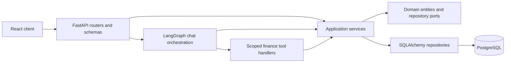
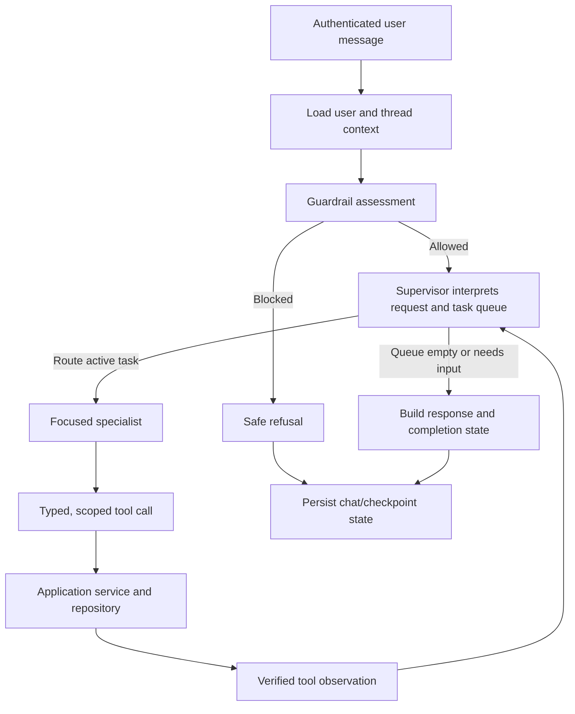

# AffordAbled: Project and Resume Reference

This document is a detailed reference for explaining AffordAbled in a resume, portfolio, or technical interview. It describes the application and architecture represented in the repository. Adapt the resume examples to your role and only add deployment, usage, or performance metrics that you have personally measured.

## 1. Project at a glance

**AffordAbled** is a personal finance web application for tracking accounts, categories, transactions, shared expenses, and spending history. It combines a conventional wallet experience with a conversational assistant that can carry out finance tasks through a controlled LangGraph workflow.

The application is designed around a clear separation of responsibility: the language model interprets requests and selects capabilities, while application services validate finance rules and database operations provide the authoritative financial facts.

| Area | Implementation |
|---|---|
| Web client | React, TypeScript, Vite, Redux Toolkit, RTK Query, Tailwind CSS |
| API | Python, FastAPI, Pydantic, asynchronous SQLAlchemy |
| Persistence | PostgreSQL, Alembic migrations, SQLAlchemy repositories |
| Conversational AI | LangGraph, LangChain tool calling, Azure OpenAI configuration |
| Receipt and voice input | Azure Document Intelligence OCR and Azure Speech-to-Text adapters |
| AI tracing and safety | LangSmith tracing configuration and NeMo semantic guardrail integration |
| Tests | pytest and pytest-asyncio on the backend; TypeScript/Vite build and ESLint on the frontend |

## 2. User-facing features

### Wallet and transactions

- Create and manage bank, cash, card, and wallet accounts; set a default account and manage account status.
- Create expense, income, refund, and transfer transactions with account/category validation and balance updates.
- Browse, edit, soft-delete, and restore transactions. Linked split transactions have additional consistency rules.
- Manage user-owned expense and income categories.
- Review an AI-created transaction in the completion flow and edit it when needed.

### Chat assistant

The chat assistant supports natural-language finance tasks, including recording expenses, managing accounts and categories, querying transactions and spending, working with splits, and creating transaction reports. The chat UI also supports receipt upload and voice transcription.

Conversation state is associated with a user-scoped thread. The graph retains bounded conversational context and structured prior results/tool observations so follow-up requests such as “before that” or “elaborate” can refer to earlier verified results.

### Receipt and voice workflows

- Receipt images are sent through an OCR service. Extracted text is included as untrusted input for the transaction workflow; the user can review or correct extracted fields.
- Receipt upload alone does not assume the user wants a split. After a transaction is recorded, chat can ask whether to split it.
- If the user supplies split instructions, the transaction is created first and split processing follows it.
- Voice audio is transcribed and the resulting text is sent through the same chat workflow.
- Processing indicators and completion dialogs communicate progress and task results.

### Splits and repayment tracking

- Create equal or custom splits tied to an existing expense.
- Custom shares are validated against the transaction total. Equal splits use deterministic remainder handling in paise.
- Track participants, amounts owed, repayments, and outstanding balances. A repayment is represented by a categorized income transaction and linked to the participant settlement.
- Itemized receipt splits can allocate priced rows to named people. The backend validates allocations and totals; the user reviews and confirms before the split is saved.
- Contact preferences are user-scoped. Preferences can guide suggestions, but they do not establish who consumed a specific item.

### Shared preference memory

The memory feature captures review events from transaction and split actions and can analyze explicitly marked chat clarifications after a transaction is saved. A durable outbox worker extracts candidate preferences from a bounded conversation excerpt, validates them against user messages and user-owned records, and passes them through the existing evidence threshold. Suggestions remain user-controlled: the current review dialog lets a person confirm or dismiss them, and only confirmed memories are supplied as preferences to relevant AI tasks.

Pending suggestions are presented in a centered dialog on Dashboard or Chat. They are not tied to the transaction-completion timer; when a completion dialog redirects from Chat to Dashboard, pending suggestions can be reopened there. The worker is an in-process polling loop configured by `MEMORY_OUTBOX_*` settings, with retries and database-backed outbox state.

### Import, export, and profile

- Import transaction CSV/XLSX files through a preview-and-confirm flow with row validation and all-or-nothing commit behavior.
- Export transaction reports as CSV, XLSX, or PDF. Generated report files omit transaction IDs, hashes, and free-text notes.
- Chat can request a transaction report and return a download action.
- Profile supports editing profile details and displays a small personalized transaction summary.

## 3. Architecture

### Application layers

The backend follows a layered structure:



- **Presentation:** FastAPI routers validate request/response contracts and derive the authenticated user from request authentication.
- **Application:** services own business operations such as transaction validation, balance changes, split calculation, imports, exports, and memory processing.
- **Domain:** entities, ports, and exceptions define the core finance concepts and repository contracts.
- **Infrastructure:** SQLAlchemy persistence, Azure integrations, LangGraph runtime, file parsing/rendering, and background jobs implement external concerns.
- **Frontend:** feature-based React pages consume typed API endpoints through RTK Query and use local state for transient UI flows.

### LangGraph workflow

At a high level, a chat turn follows this flow:



The supervisor decomposes multi-action requests into queued tasks and routes each active task to a specialist. Specialist capabilities are separated by domain, including transactions, accounts, categories, analytics, splits, and exports. A bounded runtime limits repeated routing and tool execution. When more information is needed, the graph can preserve its state and resume after the user responds.

The AI boundary is deliberately divided:

1. The **LLM** interprets language, chooses a specialist/tool, and produces a human-readable explanation.
2. **Pydantic tool schemas and runtime code** validate tool arguments and bound execution.
3. **Application services** enforce domain rules and user ownership.
4. **Repositories** return or persist the authoritative finance data.
5. The supervisor builds completion status from verified specialist results and observed tool actions.

### Finance query behavior

Transaction analytics uses one `get_transactions` capability with explicit query modes:

| Mode | Use |
|---|---|
| `recent` | Fetch a bounded number of latest transactions using an indexed recent query. |
| `previous_window` | Fetch the window preceding a previously returned transaction window. |
| `date_range` | Query explicit user-provided start and end dates. |

This avoids fetching an unbounded transaction history for ordinary “recent” questions while still supporting contextual “what came before that?” follow-ups. Aggregate queries are separate from row-level transaction queries.

### Memory event processing

```mermaid
flowchart LR
    Edit[User reviews or changes a transaction/split] --> Event[Persist review event]
    Event --> Outbox[Persist outbox row in same DB transaction]
    Outbox --> Worker[Periodic outbox worker claims a batch]
    Worker --> Candidate[Derive structured memory candidates]
    Candidate --> Suggestion[Save suggestion with evidence/confidence]
    Suggestion --> UI[User confirms, edits, or dismisses]
    UI -->|Confirmed| Context[Relevant tasks receive confirmed memory]
```



The outbox row is inserted only after its review-event row is flushed, preserving the foreign-key order observed by SQLite tests as well as production PostgreSQL. The worker uses persisted status, attempts, and retry timing; event fingerprints and unique constraints help prevent duplicate review events from producing duplicate processing records.

Chat analysis uses a separate `memory_analysis_outbox` row because conversation extraction is an LLM call. It is created only when a specialist supplies a typed memory signal, is unique per transaction, and is processed outside the request path. The analysis output is validated before it becomes an ordinary review event; candidates still need three distinct evidence events before a suggestion appears, and only user-confirmed memories are injected into future specialist context.

## 4. Important engineering decisions

### AI proposes; application code validates and executes

The LLM does not directly write arbitrary database records. Tools receive structured inputs, services revalidate ownership and business rules, and tool observations provide evidence for completion messages. Consequential operations can use confirmation or review steps.

### Financial amounts are stored as integer paise

Using integer minor units avoids floating-point drift in balances and split arithmetic. User-facing input/output is converted to rupees at presentation boundaries.

### Data access is user-scoped

The authenticated identity is injected by the server. Tool arguments do not choose a user ID. Services and repositories query records in the context of that authenticated user, including transactions, accounts, categories, splits, memories, and exports.

### Recent history is bounded

“Recent transactions” uses a database recent-query path and a result limit instead of loading the full transaction history into the LLM context. Prior-window requests advance from a previously verified result window.

### Memory updates are asynchronous and durable

The request path records review evidence and an outbox item; a worker derives suggestions later. This keeps memory derivation out of the user-facing transaction latency path while retaining a durable record to retry.

### Import is previewed before writing

Import parsing and validation return a preview. Confirmation revalidates before committing, and a failed row prevents partial imports or partial balance changes.

## 5. Resume-ready descriptions

Use the version that fits your space. Adjust tense, ownership, and technologies to match your actual contribution.

### One-line project description

> Built AffordAbled, a personal finance web app combining account and transaction management with a tool-driven conversational assistant, expense splitting, transaction import/export, and user-controlled preference memory.

### Resume bullets

- Built a full-stack personal finance application with a React/TypeScript frontend and asynchronous FastAPI backend, implementing user-scoped accounts, categories, transactions, balance updates, splits, and CSV/XLSX/PDF transaction workflows.
- Designed a LangGraph supervisor and domain-specialist architecture that routes finance requests to typed tools, maintains bounded multi-turn context, and verifies actions against service and database results.
- Implemented receipt OCR and voice transcription integrations that feed reviewed transaction workflows, with user confirmation and edit paths for uncertain or consequential changes.
- Added an asynchronous, database-backed memory outbox that converts transaction and split review events into structured, user-confirmable preference suggestions.
- Enforced ownership and financial invariants in application services, including account/category validation, balance effects, split-total checks, repayment linkage, and user-scoped analytics.

### Short portfolio summary

> AffordAbled is a personal finance platform with a standard wallet UI and an AI assistant. Users can manage accounts and transactions manually or use chat, receipt OCR, and voice transcription. A LangGraph supervisor delegates to focused finance specialists with typed tools. The application keeps financial validation and database writes in deterministic services, scopes records to the authenticated user, and stores money in paise. It also supports shared-expense splits, transaction import/export, and a durable outbox for user-reviewed preference memory.

## 6. Interview explanation: a technical challenge

### Challenge: reliable follow-ups and durable memory suggestions

The project exposed two problems that were easy to mistake for prompt issues. First, a follow-up such as “elaborate” could lose the structured result needed to answer because checkpoint messages, the product transcript, current-turn results, and tool observations had different roles. Second, memory processing could fail when a dependent outbox row was flushed before its review-event parent in SQLite.

The solution was to preserve bounded conversation context and structured prior specialist/tool results in graph state, use explicit typed tool inputs, and make the outbox insert order explicit. For transaction history, explicit `recent`, `previous_window`, and `date_range` modes made the query intent clear while keeping database retrieval bounded. For memory, event and outbox records remain tied to the operation and the worker processes them asynchronously with retryable state.

### How to describe the result

Explain the problem, where you traced it, the boundary you changed, and how you verified it. Cite only the checks you have run on the current revision. Do not claim that a feature is deployed, handles a particular number of users, or improved latency by a measured percentage without evidence.

## 7. Useful interview talking points

- Why use a supervisor and focused specialists instead of one large prompt?
- Which rules belong in an LLM prompt, and which must be enforced in code?
- How does the application prevent a tool from crossing user ownership boundaries?
- How does an integer-paise model help with split calculations and account balances?
- How does a recent-window query differ from loading all rows into an agent prompt?
- Why use an outbox for memory processing instead of running all derivation in the request?
- What does the user review before an AI-proposed transaction or itemized split is saved?
- How are chat history and LangGraph working state kept distinct?
- What would you measure next in a deployed version (tool success rate, correction rate, query latency, import error rate, and outbox retry/backlog are good candidates)?

## 8. Repository map

| Path | Purpose |
|---|---|
| `apps/api/app/presentation/` | FastAPI routers and Pydantic API schemas |
| `apps/api/app/application/services/` | Finance workflows and business rules |
| `apps/api/app/domain/` | Domain entities, repository contracts, ports, and exceptions |
| `apps/api/app/infrastructure/ai/agents/` | LangGraph supervisor, specialist runtimes, prompts, and agent contracts |
| `apps/api/app/infrastructure/ai/tools/` | Finance query and LangGraph tool adapters |
| `apps/api/app/infrastructure/database/` | SQLAlchemy models, session setup, and repositories |
| `apps/api/app/infrastructure/jobs/` | Background memory processing and retention jobs |
| `apps/web/src/features/` | Feature API slices and application state |
| `apps/web/src/pages/` | Dashboard, chat, transactions, splits, profile, and auth screens |
| `docs/` | Architecture, behavior, import/export, and implementation references |

## 9. Local development and verification

Backend development, from `apps/api`:

```powershell
pip install -r requirements.txt
alembic upgrade head
uvicorn app.main:app --reload
pytest -q
ruff check .
```

Frontend development, from `apps/web`:

```powershell
npm install
npm run dev
npm run build
npm run lint
```

The API needs environment-specific database and AI settings. Receipt OCR and voice transcription also need their Azure service credentials. LangSmith tracing is optional and depends on its configured key. Do not include secrets, local `.env` values, or personally identifying transaction data in a portfolio or repository.

## 10. Accuracy checklist before using this on a resume

- State which features you personally designed, implemented, tested, or maintained.
- Replace general ownership language with your actual role (for example, “designed and implemented” only where accurate).
- Add only measured outcomes: test counts from the revision you ran, latency/load numbers, user counts, or deployment details.
- Do not list planned integrations or infrastructure as implemented unless the repository and deployment actually use them.
- Be prepared to explain one end-to-end flow, one authorization boundary, and one failure you debugged.
