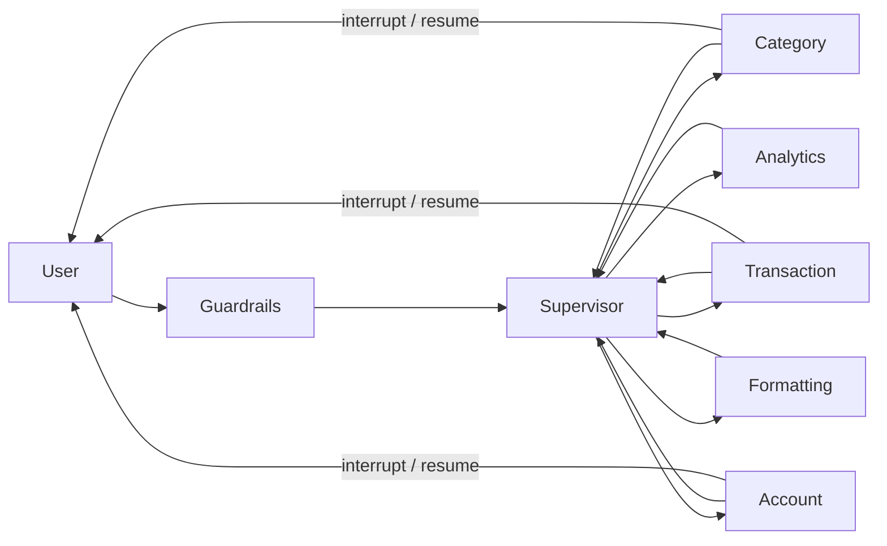

# Agentic Chat Architecture

Each specialist receives a typed `HandoffContext` and may return only a typed
`SpecialistResult`. A specialist's `SpecialistRuntime` enforces its tool registry,
iteration cap, timeout, and tool retry cap. The supervisor has no domain tools.

To add a specialist, define its prompt, expose only its authorized tool handlers,
construct a `SpecialistRuntime`, and register it with the supervisor. Tool handlers
must scope every repository/service call to `HandoffContext.user_id`.

`AgenticSupervisorGraph` accepts either one shared LLM or a mapping keyed by
`supervisor`, `category`, `transaction`, `account`, `analytics`, and `formatting`
(with an optional `default`). This makes model choice configurable per agent while
keeping prompts in `agents/prompts.py`.

`interrupt()` is invoked inside the specialist runtime. LangGraph persists the graph
checkpoint; the next chat turn resumes the same runtime and adds the answer as a
`user_input` observation for the specialist brain.
