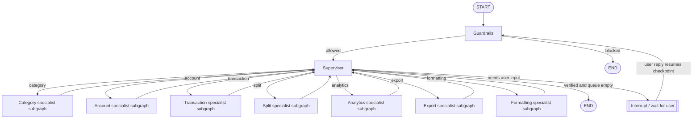
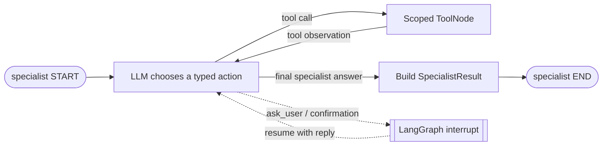
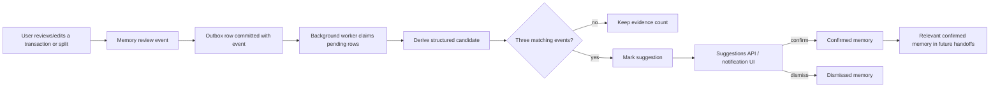

# AffordAbled LangGraph Architecture Guide

This guide explains how chat requests move through AffordAbled, how LangGraph keeps a task alive across tools and user clarifications, how specialists are restricted to their own capabilities, and how transaction/split review events become optional long-term memory.

It describes the implementation in `apps/api/app/infrastructure/ai/agents/` and its application-service, database, and API collaborators. The graph uses an LLM to interpret language and choose actions; financial rules and persistence remain in application services and repositories.

## 1. What the system is designed to do

The chat assistant should be able to:

- Interpret one request or several ordered requests in one message.
- Route each active task to a domain specialist with only relevant tools.
- Ask a focused question when required information is missing, then resume the same operation when the user answers.
- Use authoritative tool observations to verify a mutation instead of trusting an LLM statement that it succeeded.
- Preserve useful working context across turns, including prior tool results for follow-ups such as “elaborate” and “what about before that?”
- Keep each user's accounts, categories, transactions, splits, memories, and chat threads scoped to that authenticated user.

The LLM is responsible for interpreting intent and selecting actions. The application is responsible for validating inputs, enforcing ownership, doing exact money calculations, persisting data, and reporting what the tools actually returned.

## 2. Where the code lives

| Responsibility | Main implementation |
| --- | --- |
| Root graph, state, routing, task queue, follow-ups | [`supervisor_graph.py`](../apps/api/app/infrastructure/ai/agents/supervisor_graph.py) |
| Specialist schemas, tool registration, execution and tool loop | [`runtime.py`](../apps/api/app/infrastructure/ai/agents/runtime.py) |
| LLM prompt and structured decision adapters | [`brains.py`](../apps/api/app/infrastructure/ai/agents/brains.py) |
| Specialist policies | [`prompts.py`](../apps/api/app/infrastructure/ai/agents/prompts.py) |
| Typed handoff, tool and result contracts | [`contracts.py`](../apps/api/app/infrastructure/ai/agents/contracts.py) |
| Domain-specific tool handlers | `category.py`, `account.py`, `transaction.py`, `split.py`, `analytics.py`, `export.py` |
| Chat API and orchestration adapter | [`chat_router.py`](../apps/api/app/presentation/routers/chat_router.py), [`chat_service.py`](../apps/api/app/application/services/chat_service.py) |
| Checkpointer and background worker startup | [`main.py`](../apps/api/app/main.py) |
| Review-event and memory logic | [`memory_service.py`](../apps/api/app/application/services/memory_service.py), [`sqlalchemy_memory_repository.py`](../apps/api/app/infrastructure/database/repositories/sqlalchemy_memory_repository.py) |

## 3. The graph at a glance

The outer graph is a supervisor graph. The supervisor itself has no financial tools. It delegates the active task to one specialist, receives structured results, verifies progress, and decides whether to route again or finish.



Each specialist has an inner tool loop:



The actual root graph is built in `AgenticSupervisorGraph.__init__`: it adds `guardrails`, `supervisor`, and one attached subgraph per specialist. A specialist returns to the supervisor after it finishes. A LangGraph interrupt pauses execution while preserving the checkpoint.

The graph wiring is intentionally small; most policy is in the node functions and specialist prompts:

```python
graph = StateGraph(AgentGraphState)
graph.add_node("guardrails", self._guardrails)
graph.add_node("supervisor", self._supervise)
for name, specialist in self._specialists.items():
    graph.add_node(name, specialist.build_persistent_subgraph(AgentGraphState))

graph.add_edge(START, "guardrails")
graph.add_conditional_edges("guardrails", self._after_guardrails, {
    "supervisor": "supervisor", END: END,
})
graph.add_conditional_edges("supervisor", self._after_supervisor, specialist_routes)
for name in self._specialists:
    graph.add_edge(name, "supervisor")
compiled = graph.compile(checkpointer=checkpointer)
```

`specialist_routes` maps each specialist name back to its graph node, plus `supervisor` and `END`.

## 4. What is in graph state?

`AgentGraphState` is the shared state contract. Not every key is populated in every turn. The important fields are:

| State field | What it is for |
| --- | --- |
| `messages` | LangChain messages used by the current graph execution/checkpoint. |
| `conversation_history` | Bounded user-visible transcript used to understand conversational references. It has a reducer so resumed or attached subgraphs can safely merge updates. |
| `task_request` | The original active user request. It survives a clarification answer. |
| `task_queue` | Ordered, unfinished actions identified for the current request. Only the first task is active. |
| `completed_tasks` | Verified task summaries accumulated while the queue is being processed. |
| `created_transaction_ids` | Transaction IDs created in the current multi-step operation; a later split can use one of these. |
| `pending_split_transaction_id` | The transaction a split correction or resumption belongs to. |
| `available_categories`, `available_accounts` | User-scoped snapshots provided as routing context. Tool observations remain authoritative if the data changes. |
| `confirmed_memories` | Confirmed preferences relevant to assistant decisions. Suggested or dismissed memories are not treated as facts. |
| `specialist_messages` | Working messages for the current specialist subgraph. This is separate from the visible transcript. |
| `results`, `prior_results` | Current specialist results and a small window of earlier structured results for follow-ups. |
| `tool_event_history` | Bounded, timestamped tool observations used for verification and contextual follow-ups. |
| `last_transaction_window` | A verified analytics window, so a later “before that” can query the preceding window. |
| `awaiting_user_input`, `tasks_completed`, `show_completion_popup` | Control/UI outcome flags. |

The message reducer for `conversation_history` is deliberate: in a graph, two nodes may contribute state in one step. A plain list field can cause `INVALID_CONCURRENT_GRAPH_UPDATE`. The reducer recognizes a full-prefix snapshot or merges divergent tails, then caps history to a bounded size.

Example state after “Create Medicines and record ₹99 at the pharmacy” might conceptually be:

```python
{
    "task_request": "Create Medicines and record ₹99 at the pharmacy",
    "task_queue": [
        "Create Medicines as an expense category",
        "Record ₹99 at the pharmacy under Medicines",
    ],
    "completed_tasks": [],
    "created_transaction_ids": [],
    "available_categories": [...],
    "available_accounts": [...],
}
```

The state contains IDs internally so tools can link records. User-facing exports deliberately omit IDs and sensitive hash data.

## 5. One chat request from browser to graph

1. The browser sends a message, optional thread ID, and timezone to `POST /api/v1/chat`.
2. FastAPI authenticates the user. `chat_router.py` calls `ChatService.send_message` with the authenticated user's ID; the LLM does not choose the user identity.
3. `ChatService` calls the `ChatOrchestrator` port. The production adapter is `AgenticChatOrchestrator` around `AgenticSupervisorGraph`.
4. The graph uses a checkpoint key of `user_id:thread_id`. This prevents the same thread ID belonging to two users from sharing graph state.
5. The guardrail evaluates the latest user message. A blocked request ends before specialist routing.
6. The supervisor receives the active request, relevant transcript, current category/account snapshots, confirmed memories, previous results, and recent tool observations.
7. It decides the ordered work, routes one task to one specialist, and reviews the result.
8. Once all requested work is verified, the graph produces a final response and flags whether a completion popup should be shown.
9. If conversation storage is enabled for the user, `ChatService` separately writes the visible user/assistant transcript and thread metadata to the chat tables.

### Two kinds of chat persistence

These are related but not interchangeable:

- **LangGraph checkpointer:** saves execution state, pending interrupts, and graph context. PostgreSQL is the durable production option. In-memory mode loses checkpoints on restart.
- **Conversation tables:** save the visible thread title and messages for the sidebar/history experience, controlled by the user's conversation-storage setting.

The checkpointer is used even though a separate transcript exists: the transcript is optimized for display; the checkpoint is optimized for resuming a graph in the middle of a workflow.

## 6. Task planning and the smart queue

On the first supervisor decision for a new request, the LLM may return `tasks`, an ordered list of actions. A small deterministic layer supplements this list for explicit “A and B” action clauses and for the important transaction-then-split pattern.

For example:

> “Spent ₹1,500 on dinner with Isha and Piyush. Split it equally.”

The graph must do these in order:

```text
1. Record the ₹1,500 expense.
2. Create an equal split linked to the newly created transaction ID.
```

It cannot create the split first because a split must reference an existing expense. After task 1 succeeds, the supervisor stores the returned transaction ID in `created_transaction_ids` and advances the queue. The split specialist receives that ID in its trusted handoff.

### How queue completion is verified

The supervisor does not remove work just because the specialist says “done.” It inspects successful tool observations and calls `_reconcile_task_queue` / `_matches_observed_action` to associate them with requested tasks. This was added to prevent cases where:

- One specialist call handled several names but the queue still contained a duplicate task.
- A task was reported complete without a successful tool result.
- A clarification answer such as “expense” was mistaken for the whole category-creation task.
- A transaction was recorded but its requested split had not yet been created.

When a specialist's verified mutation satisfies the active task, that task is removed. The supervisor repeats until the queue is empty. Only then can `tasks_completed=True` and the completion-popup flag be set.

## 7. Clarifications and interrupts

When a specialist needs a user answer, it calls the LangGraph `interrupt()` mechanism. This is a pause in the existing graph execution, not a new unrelated task.

Example:

```text
User: Create Food and Groceries categories.
Assistant: Should those be expense or income categories?
User: Expense.
```

On the first turn, the graph saves a checkpoint with the pending question and the original request. On the next turn, `invoke()` detects the checkpoint interrupt and uses `Command(resume=...)`. The specialist sees the original task plus the newest reply and creates both categories. The answer “Expense” is a required field, not a task on its own.

Other examples that can pause include:

- No account exists for a requested expense. The transaction specialist asks once; if the user wants a new account, the supervisor queues account creation and then resumes the original transaction.
- A category is ambiguous. The specialist lists categories and asks the user to select one.
- Deleting financial data. Destructive actions require explicit confirmation.
- Itemized splits. The split tool calculates shares and asks for approval before saving. If the user corrects the allocation, it resumes the pending split without recording the transaction again.

The response returned to the frontend is derived from `__interrupt__` when present. A paused request is not reported as complete and does not trigger the success popup.

## 8. Specialists and their tools

Each specialist has a narrow prompt and a narrow registry. `ToolBoundSpecialistRuntime` binds only those functions to its model and validates tool arguments with a Pydantic schema. The execution handler builds a trusted `HandoffContext` from graph state, including the server-authenticated `user_id`, active queued task, timezone, categories/accounts, recent results, and confirmed memories.

| Specialist | Typical work | Example capabilities |
| --- | --- | --- |
| Category | Create, list, rename/update, or delete categories | `list_categories`, `create_category`, `update_category`, `delete_category` |
| Account | Create, list, update, activate/deactivate, choose default | `list_accounts`, `create_account`, `set_default_account`, `rename_account` |
| Transaction | Record, batch-record, list, update, delete/restore, extract ambiguous details | `create_transaction`, `create_transaction_batch`, `list_transactions`, `extract_transaction` |
| Split | Create an equal/custom or itemized split; inspect contacts/preferences | `create_split`, `list_split_contacts`, `set_split_contact_preference` |
| Analytics | Read balances, recent/previous/date-range transactions, summaries/comparisons, split balances | `get_account_balances`, `get_transactions`, `get_spending_summary`, `get_split_summary` |
| Export | Generate a user-scoped transaction report | `create_transaction_report` |
| Formatting | Turn structured result data into a concise answer; no mutation tools | No tools |

There are two runtime styles in the codebase: a direct decision runtime (`SpecialistRuntime`) and the LangGraph `ToolBoundSpecialistRuntime` used by the attached production subgraphs. The latter runs `agent -> ToolNode -> agent` until the model finishes or the iteration limit is reached. Tool observations are parsed into `SpecialistResult`, preserving status, summary, actions, data, and errors.

### Example: recording a transaction

For “Spent ₹250 at Cafe Rio on Food”:

1. The supervisor routes to transaction.
2. The transaction prompt says to use the injected account/category snapshot and call list tools when needed.
3. The specialist chooses `create_transaction` with rupees and resolved IDs.
4. `TransactionToolset` converts rupees to integer paise and calls `TransactionService`.
5. The service validates account ownership, category ownership/type, amount, and balance effects; the repository persists the transaction.
6. The tool returns an observation containing the created transaction. The specialist summarizes it.
7. The supervisor confirms the tool observation matches the request, removes the task, and returns the verified result.

Money is stored as integer paise. This avoids using binary floating-point as the source of truth for amounts.

### Example: analytics and “before that”

For “Show my recent transactions,” the analytics specialist calls `get_transactions` in `recent` mode. The tool returns a bounded result window and its dates; it does not load the user's entire history. The graph stores that verified window in `last_transaction_window`.

For the next message “What about before that?”, the supervisor sees the prior analytics result and window. The analytics tool uses `previous_window` and asks the query layer for the preceding period. A follow-up such as “elaborate” can reuse `prior_results` and `recent_tool_observations`; it does not need to guess or ask what the user means when the prior result is clear.

### Example: split participants and owner share

For a ₹900 expense split equally with Isha and Piyush, the owner plus those two people are involved, so each share is ₹300. The owner is represented by `owner_share_paise`; only Isha and Piyush are external participant records.

For itemized splits, `me` is allowed as a marker in an item's `shared_by` list to mean the owner consumed that item. It is never an external contact. The prompt says not to ask what to call the owner, the tool removes owner aliases if the model mistakenly puts them into the participant list, and `SplitService` rejects owner aliases at the persistence boundary. Exact share calculation is handled by `calculate_itemized_split`, not the LLM.

The split service checks totals and participant limits. The split repository persists the split and participants. The `SplitService` also creates a review event for split creation/editing; this event is the evidence source for split-preference candidates.

## 9. Receipts, OCR, and voice

Image and voice endpoints are input-preparation routes. They do not replace the chat graph:

- `POST /api/v1/chat/image` validates and analyzes an image, then returns extracted text plus a generated prompt for chat.
- The receipt prompt says one receipt means one transaction using the final grand total. Receipt line items are evidence, not separate transactions.
- OCR alone never implies a split. The prompt asks whether the user wants to split after the transaction is logged; a split needs explicit user intent and participants.
- Voice transcription returns text. The frontend sends that text through the normal chat request so the same graph, tools, task queue, and checkpoints apply.
- When the AI/network path fails, the frontend has a manual transaction entry fallback; manual entry does not depend on a successful graph run.

This separation keeps all transaction decisions in one consistent execution path after input has been converted to text.

## 10. Memory: review events to suggestions

Memory is deliberately not written by asking an LLM to invent a profile. It is derived from structured user actions and review outcomes.



Current candidate examples include:

- A user changes a merchant's category repeatedly: candidate `{scope: "merchant", subject: "apollo pharmacy", type: "category_mapping", value: {category_id: ...}}`.
- A user changes a merchant's account repeatedly: `account_mapping`.
- A user repeatedly creates or edits the same split mode/share pattern with a named person: `split_method` for that external person.

Each candidate gets a deterministic fingerprint. The outbox event is committed together with its review event, then the worker claims batches, retries failures with backoff, and processes events idempotently. A memory becomes visible as a suggestion after three evidence events. The current grouping is based on a candidate's normalized identity/value, so materially different values can form separate patterns.

Only confirmed memories are loaded into a supervisor handoff as preferences. A suggested memory does not influence transactions/splits as if it were already true. Users can confirm, dismiss, edit, or delete memories through the memory API/UI.

The memory worker starts from the FastAPI lifespan when `MEMORY_OUTBOX_ENABLED` is true (default true), polling every five seconds by default. Look for `memory.outbox.scheduler.started`, `memory.outbox.completed`, and `memory.outbox.*failed` in API logs. If the worker cannot connect to the database, events can remain queued and suggestions will not appear. The asyncpg session URL must use `ssl`, not libpq's `sslmode` parameter.

The current memory fingerprint groups an **exact candidate value**. For split patterns that includes the split mode and recorded share ratio, so three shares of exactly 25% can produce a suggestion, while 25%, 30%, and 33% currently form separate candidates. This is one reason a user can have review activity but still see no suggestion: there may not yet be three matching events.

## 11. Authorization and trust boundaries

The model is not an authorization layer. Every tool handler receives the authenticated user ID from graph state, which is initially populated by the API service. Services/repositories query by that user ID. Resource IDs proposed by an LLM are checked against that user's records before mutation/read.

The trusted boundary is:

```text
JWT-authenticated API request
  -> current_user.id
  -> HandoffContext.user_id (server-created)
  -> tool handler with scoped service call
  -> repository query filtered by user_id
```

The LLM may choose a tool and supply arguments, but it cannot choose another owner identity. The specialist's tool registry is also a capability boundary: category tools are not available to analytics, and analytics is read-only. Deletion is confirmed before the tool can execute.

Tool arguments and results should be treated as untrusted inputs/observations. Domain validation still checks monetary values, transaction types, account/category compatibility, split totals, and ownership. Successful `ToolObservation` data, not free-form model text, is the evidence used by the supervisor to mark a task complete.

## 12. Checkpointing, thread identity, and transcript storage

`AgenticSupervisorGraph.invoke()` loads a snapshot before invoking the graph. The configured checkpointer is compiled into the graph and addressed with `thread_id=f"{user_id}:{thread_id}"`.

- PostgreSQL saver: durable LangGraph checkpoint tables; startup calls `setup()`.
- In-memory saver: useful for local/testing, but pending operations disappear on process restart.
- `LANGGRAPH_CHECKPOINTER_MODE=postgres`: strict mode; startup fails instead of silently losing durability if Postgres cannot initialize.

Separately, `ChatService` persists the visible transcript and thread metadata when `conversation_storage_enabled` is on. The transaction chat route resolves or creates a thread linked to the transaction, so a different device can open the same persisted chat if it has the same authenticated account and thread association.

## 13. Useful ways to reason about failures

When a request fails, inspect these in order:

1. **Was the active request understood?** Check the supervisor input, `task_request`, and `task_queue`.
2. **Did it route to the correct specialist?** Check `next_specialist` and its handoff.
3. **Was the needed tool available?** Check the specialist registry and tool schema.
4. **What did the tool actually return?** Inspect each `ToolObservation` (`ok`, arguments, data, error).
5. **Did the supervisor reconcile that observation against the right queued task?** Check `completed_tasks`, remaining queue, and `_matches_observed_action` conditions.
6. **Was there an interrupt?** If so, it is waiting for a user answer; it is not an incomplete graph crash.
7. **Was graph state durable?** Check the app's `langgraph_checkpointer_backend` and startup logs.
8. **For absent memory suggestions:** check review-event count, outbox statuses/errors, candidate evidence counts, and whether there are three matching events. Also check worker startup and DB connection logs.

LangSmith traces can show the root graph, attached specialist subgraph, model calls, tool calls, and returned observations. Avoid placing credentials, raw tokens, or unnecessary sensitive transaction details into trace metadata.

## 14. Compact end-to-end example

Request:

> “Spent ₹2,000 on dinner with Isha and Piyush. ₹750 was chicken; Piyush is vegetarian. Split the rest equally.”

Conceptual execution:

```text
API authenticates user and receives request
  -> guardrail allows personal-finance task
  -> supervisor creates ordered transaction + itemized-split tasks
  -> transaction specialist resolves account/category and records ₹2,000
  -> tool observation returns transaction ID T
  -> supervisor verifies transaction task and advances queue
  -> split specialist gets T, Isha/Piyush, confirmed preferences
  -> exact itemized calculator allocates chicken only to eligible sharers
  -> tool interrupts with a proposed breakdown for user review
  -> user confirms or corrects
  -> split is saved against T; user share stays separate from contacts
  -> supervisor verifies split observation and empties queue
  -> API returns final response and completion-popup flag
```

The LLM interprets “Piyush is vegetarian” and which items each person shared, but the prompt requires it to ask when an assignment is uncertain. The calculator performs exact paise allocation; tool/service validation enforces the total. The user must confirm the itemized split before it is saved. This division of work is the main architectural principle: language understanding is probabilistic, financial persistence and arithmetic are validated application behavior.

The underlying calculation is ordinary application code, for example:

```python
calculation = calculate_itemized_split(
    total_paise=200_000,
    participant_names=["Isha", "Piyush"],  # external people only
    items=[
        ItemAllocation("Chicken", 75_000, ["me", "Isha"], food_type="contains_meat"),
        ItemAllocation("Other food", 125_000, ["me", "Isha", "Piyush"]),
    ],
    preferences={"piyush": "vegetarian"},
)
```

Here, `me` is a marker in `shared_by`, not a participant record. The result has a separate owner share plus shares for Isha and Piyush; integer remainder paise are assigned deterministically. Because the second row's ingredients are unknown, the calculator can return a warning for Piyush instead of assuming that it is vegetarian.

## 15. Architecture trade-offs and current limits

- The supervisor is a single planning/routing brain; specialists own domain actions. This keeps tool permissions and prompts focused while allowing multi-domain tasks.
- The task queue is explicit state rather than relying only on a long transcript. It makes ordering and “all requested work is complete” machine-checkable.
- The transcript and specialist working messages are separate. Specialist messages can be reset at handoff without deleting what the user said.
- Tool calls are bounded by schemas, retries, timeouts, and iteration limits. Failures should be surfaced as partial/failed observations rather than converted to success.
- Some fast-path routing and task recognition is deterministic alongside LLM reasoning. This is intentional for fixed safety/order constraints such as transaction-before-split and repeatable request patterns.
- Memory is currently structured and evidence-count based, not a free-form semantic memory model. Three-evidence thresholds and candidate normalization can delay or fragment suggestions; those are policy choices that can be tuned separately from the graph architecture.
- The in-process outbox worker is simple to deploy, but each API instance may run its own poller. Row locking and `skip_locked` are used for claims; a separate worker service can be introduced if throughput or independent scaling becomes necessary.

## 16. Suggested reading order in the source

1. Read `contracts.py` for the typed request/decision/result envelopes.
2. Read `supervisor_graph.py` for state, checkpoint loading, task planning, routing, queue reconciliation, and output conversion.
3. Read `brains.py` and `prompts.py` to see the LLM contracts and specialist operating rules.
4. Read `runtime.py` for tool schemas, registries, interrupt behavior, tool execution, observations, and the inner specialist subgraph.
5. Read one toolset such as `transaction.py` or `split.py`, then its application service and repository.
6. Read `memory_service.py`, `sqlalchemy_memory_repository.py`, and `memory_jobs.py` for review-event processing.
7. Read `chat_service.py` and `threads_router.py` to distinguish graph checkpoints from persisted user-visible chat history.
