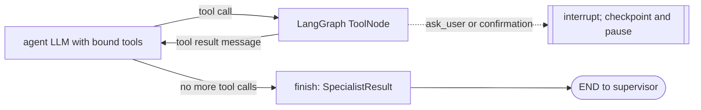
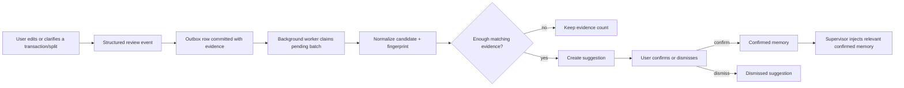

# AffordAbled LangGraph: End-to-End Architecture Guide

This is a practical guide to how AffordAbled's AI chat works today: how a message becomes a task, how the supervisor routes that task, how specialist agents use tools, how the graph pauses and resumes, and how verified results reach the UI. It also explains the reliability failures we encountered and the rules that prevent them.

The important design boundary is:

> The LLM interprets language and chooses among permitted actions. Application services validate business rules, enforce user ownership, calculate money, and persist records. The graph uses tool observations, not a confident-sounding answer, to decide whether work is complete.

## Start with the vocabulary

| Term | Meaning in this application |
| --- | --- |
| Root graph / supervisor graph | The LangGraph workflow that plans work, routes tasks, tracks progress, and creates the final response. |
| Supervisor | The LLM decision node that chooses whether to route, finish, or refuse, and may plan an ordered task list. It has no direct financial mutation tools. |
| Specialist | A scoped agent for categories, accounts, transactions, splits, analytics, exports, or formatting. |
| Tool | A typed capability exposed to a specialist, such as `create_transaction` or `get_transactions`. The handler calls application services. |
| Handoff | A trusted, structured context packet given to a specialist: active task, history, timezone, user-scoped snapshots, previous results, and relevant constraints. |
| Task queue | The ordered list of requested operations not yet verified as complete. Only its first item is the active task. |
| Tool observation | The structured success or error returned by executing a tool. It is the evidence used for task completion. |
| Checkpoint | Saved LangGraph execution state for one user/thread, including the queue and pending interrupt state. |
| Transcript | User-visible chat messages stored for chat history/sidebar. This is separate from the graph checkpoint. |
| Interrupt | A deliberate pause for a user answer or confirmation. The same graph thread resumes afterward. |

## Where the code lives

| Layer | Files | Responsibility |
| --- | --- | --- |
| HTTP/API entry | [`chat_router.py`](../apps/api/app/presentation/routers/chat_router.py), [`chat_service.py`](../apps/api/app/application/services/chat_service.py) | Authenticate request, pass authenticated user ID and message to orchestration, persist visible transcript, build API response. |
| Graph orchestration | [`supervisor_graph.py`](../apps/api/app/infrastructure/ai/agents/supervisor_graph.py) | State schema, graph construction, checkpoint resume, task queue, supervisor routing/reconciliation, final response. |
| LLM contracts | [`brains.py`](../apps/api/app/infrastructure/ai/agents/brains.py), [`contracts.py`](../apps/api/app/infrastructure/ai/agents/contracts.py) | Structured inputs/outputs for supervisor and specialist decisions, observations, and results. |
| Prompts | [`prompts.py`](../apps/api/app/infrastructure/ai/agents/prompts.py) | Role-specific instructions, constraints, and tool-use policies. |
| Specialist runtime | [`runtime.py`](../apps/api/app/infrastructure/ai/agents/runtime.py) | Tool schemas, scoped registries, LangGraph `ToolNode` subgraphs, state injection, retry/timeout/interrupt handling, observation parsing. |
| Domain tool adapters | [`category.py`](../apps/api/app/infrastructure/ai/agents/category.py), [`account.py`](../apps/api/app/infrastructure/ai/agents/account.py), [`transaction.py`](../apps/api/app/infrastructure/ai/agents/transaction.py), [`split.py`](../apps/api/app/infrastructure/ai/agents/split.py), [`analytics.py`](../apps/api/app/infrastructure/ai/agents/analytics.py), [`export.py`](../apps/api/app/infrastructure/ai/agents/export.py) | Translate validated tool arguments and trusted context into application-service calls. |
| Persistence and startup | [`main.py`](../apps/api/app/main.py), database repositories, [`memory_jobs.py`](../apps/api/app/infrastructure/jobs/memory_jobs.py) | Configure the checkpointer, initialize its schema, run background jobs, and persist application data. |
| Memory | [`memory_service.py`](../apps/api/app/application/services/memory_service.py), [`sqlalchemy_memory_repository.py`](../apps/api/app/infrastructure/database/repositories/sqlalchemy_memory_repository.py) | Record review evidence, process outbox events, build suggestions, and supply confirmed preferences. |

## The complete path of a chat request

```mermaid
sequenceDiagram
    participant UI as Web UI
    participant API as Chat router/service
    participant Root as Supervisor graph
    participant Sup as Supervisor LLM
    participant Spec as Specialist subgraph
    participant Tool as Scoped tool adapter
    participant Svc as Application service/repository
    participant DB as PostgreSQL

    UI->>API: POST /api/v1/chat (message, thread, timezone)
    API->>API: Authenticate JWT; obtain trusted user_id
    API->>Root: run_turn(user_id, thread_id, message)
    Root->>DB: Load checkpoint for user_id:thread_id
    Root->>Root: Append message, detect pending interrupt/follow-up
    Root->>Sup: Guardrail + trusted handoff context
    Sup-->>Root: Route one task / finish / refuse
    Root->>Spec: Enter selected specialist subgraph
    loop Until specialist finishes or asks user
        Spec->>Spec: LLM selects a permitted tool or final summary
        Spec->>Tool: ToolNode executes typed call
        Tool->>Svc: Call with authenticated user scope
        Svc->>DB: Validate and read/write records
        DB-->>Svc: Result
        Svc-->>Tool: Authoritative result/error
        Tool-->>Spec: Tool observation
    end
    Spec-->>Root: SpecialistResult + tool observations
    Root->>Sup: Reconcile result against active queue item
    alt More queued work remains
        Sup->>Root: Route next task
    else Complete
        Root-->>API: Final response + popup/completion metadata
        API->>DB: Persist transcript if enabled
        API-->>UI: Chat response
    else Needs answer
        Root-->>API: Interrupt question; keep checkpoint
        API-->>UI: Ask user; do not show success completion
    end
```

In code, `AgenticSupervisorGraph` compiles one root graph with a `guardrails` node, a `supervisor` node, and an attached specialist subgraph for each specialist. Specialists return to the supervisor. The supervisor either routes another specialist, finishes, or lets an interrupt bubble back to the API.

Simplified graph wiring:

```python
graph = StateGraph(AgentGraphState)
graph.add_node("guardrails", self._guardrails)
graph.add_node("supervisor", self._supervise)
for name, specialist in self._specialists.items():
    graph.add_node(name, specialist.build_persistent_subgraph(AgentGraphState))

graph.add_edge(START, "guardrails")
graph.add_conditional_edges("guardrails", self._after_guardrails, {
    "supervisor": "supervisor", END: END,
})
graph.add_conditional_edges("supervisor", self._after_supervisor, specialist_routes)
for name in self._specialists:
    graph.add_edge(name, "supervisor")
graph.compile(checkpointer=checkpointer)
```

The actual implementation also provides routing fallbacks, task reconciliation, interrupts, follow-up recovery, and UI metadata.

## The graph state: what is remembered while it runs?

`AgentGraphState` is the shared typed state checkpointed by LangGraph. It is not identical to the visible chat transcript.

| Field/group | Role |
| --- | --- |
| `messages` | Root LangChain message channel. Uses `add_messages`. |
| `conversation_history` | Bounded user/assistant transcript used for conversational context. Uses a custom reducer to merge updates safely and is capped at 100 entries. Specialists receive the most recent 20. |
| `task_request` | Original user request for the active operation. It must survive replies such as “Health” or “yes.” |
| `task_queue`, `completed_tasks` | Ordered pending work and verified completed work. |
| `results`, `prior_results` | Structured specialist result(s) for this turn and a small prior window for follow-ups. |
| `tool_event_history` | Bounded, timestamped observations with tool, specialist, active task, and original request. |
| `created_transaction_ids`, `pending_split_transaction_id` | Link a later split to the transaction already created, including after a split correction/resume. |
| `available_categories`, `available_accounts`, `available_split_contacts` | User-scoped snapshots refreshed by the supervisor. Useful for grounding; tools remain authoritative if snapshots become stale. |
| `confirmed_memories` | Confirmed preferences relevant to future suggestions. Suggestions are not treated as confirmed facts. |
| `last_transaction_window` | Window returned by a prior transaction analytics query, so “before that” can refer to the preceding window. |
| `specialist_messages`, `specialist_steps` | Specialist working history and iteration count. Working messages are reset at handoff; this does not erase `conversation_history`. |
| `next_specialist`, `handoff`, `reroutes` | Routing decision and specialist handoff metadata. |
| `awaiting_user_input`, `tasks_completed`, `show_completion_popup`, `final_response` | Control and response state returned to the API/UI. |

The custom `conversation_history` reducer matters. More than one node can update a state key during one graph step. Without a reducer, LangGraph can raise `INVALID_CONCURRENT_GRAPH_UPDATE`. The reducer recognizes old history snapshots and new appended entries, merges the new tail, and bounds the stored history.

Example state after the supervisor plans “Create a Medicines category, then record ₹99 at the pharmacy”:

```python
{
    "task_request": "Create Medicines and record ₹99 at the pharmacy",
    "task_queue": [
        "Create Medicines as an expense category",
        "Record ₹99 at the pharmacy under Medicines",
    ],
    "completed_tasks": [],
    "created_transaction_ids": [],
    "available_categories": [...],
    "available_accounts": [...],
}
```

## Planning and the smart task queue

The supervisor brain returns a typed `SupervisorDecision`: `route`, `finish`, or `refuse`, plus an optional ordered `tasks` list and handoff. The queue is explicit because the system must know which requested actions remain; a natural-language success sentence alone cannot establish that.

Some task planning uses deterministic helpers alongside LLM planning. Helpers recognize clear multi-action clauses and impose required order, particularly transaction-before-split. This is an intentional boundary: the LLM interprets flexible language, while fixed dependencies should not depend on a model remembering an ordering rule every time.

Example:

> “Spent ₹1,500 on dinner with Isha and Piyush. Split it equally.”

The work must be sequenced:

```text
1. transaction specialist records the ₹1,500 expense
2. successful tool observation returns transaction ID T
3. supervisor verifies task 1 and advances the queue
4. split specialist receives T and creates a split linked to T
5. split tool returns a proposal or saved result
6. supervisor verifies task 2 and finishes when the queue is empty
```

Queue reconciliation in `_reconcile_task_queue` and `_matches_observed_action` matches successful tool observations to tasks. A specialist completing multiple requested entities in one tool run can consume multiple matching queue entries. Category creation also checks the refreshed category list so an already-existing category is treated idempotently. Special recovery paths handle operations where the earlier successful observation is in checkpoint history (for example, a transaction follow-up) and therefore is not repeated in the latest result.

The queue should not be “smart” by deleting tasks based on a model summary. It should be reconciled using tool evidence, current scoped state, and narrow tested recovery rules. Otherwise “it says it did both” can hide a missed write.

## What the supervisor does each time

The supervisor node refreshes user-scoped categories, accounts, split-contact names, and relevant confirmed memories. It builds `HandoffContext` containing:

- authenticated `user_id` supplied by the API, never chosen by the model;
- the active task (normally queue item zero), plus original request and latest reply;
- recent transcript, bounded prior specialist results, and recent tool observations;
- timezone, current accounts/categories/contacts, confirmed memories;
- transaction IDs and split transaction ID needed for ordering/linkage.

It asks the structured supervisor LLM for a decision, then applies routing fallbacks and completion logic. Examples of deterministic behavior include routing an obvious next transaction after account/category setup, ensuring a receipt prompt's optional split text is not mistaken for split consent, and handling “elaborate” against the previous verified result.

## Specialists and their authority

| Specialist | Typical request | Representative tools |
| --- | --- | --- |
| Category | Create/list/update/delete categories | `list_categories`, `create_category`, `update_category`, `delete_category` |
| Account | Create/list/update/default/activate/deactivate accounts | `list_accounts`, `create_account`, `update_account`, `set_default_account`, etc. |
| Transaction | Create/list/update/delete/restore/extract transactions | `create_transaction`, `create_transaction_batch`, `list_transactions`, `update_transaction`, `extract_transaction` |
| Split | Create equal/custom/itemized split and inspect contacts/preferences | `list_split_contacts`, `create_split`, `set_split_contact_preference` |
| Analytics | Read balances, transaction windows, spending, and split balances | `get_account_balances`, `get_transactions`, `get_spending_summary`, `get_split_summary` |
| Export | Build a user-scoped transaction report | `create_transaction_report` |
| Formatting | Explain already-computed structured results | No mutation tools |

Every specialist has its own prompt and registry. The LLM can only call tools in that registry, and each tool has a schema. It does not gain another specialist's tools by asking for them in text. The registry is a capability boundary, but application-service authorization is still the security boundary.

## Inside one specialist: the tool loop

`ToolBoundSpecialistRuntime.build_persistent_subgraph` creates a subgraph with three nodes:



When a tool is called:

1. `ToolNode` validates the model-visible arguments using the registered Pydantic schema.
2. Injected LangGraph state is used to construct trusted `HandoffContext`; `user_id` is not model-visible tool input.
3. Destructive operations require confirmation before their handler runs.
4. `_call_handler` serializes calls using a shared `asyncio.Lock` because agents in one request share an `AsyncSession`, which cannot safely be used concurrently.
5. The adapter calls the application service, catches ordinary failures into `ToolObservation(ok=False, error=...)`, rolls the session back after failures, and retries within a bounded timeout. `GraphBubbleUp` is re-raised because it represents control flow, not an ordinary tool error.
6. The result becomes a tool message. The LLM can inspect it and make another tool call or finish.
7. The finish node parses tool messages and the final assistant message into `SpecialistResult`, including `status`, `summary`, `data`, `actions_taken`, `tool_observations`, and `errors`.

No-argument tool schemas need explicit defaults. For example, `list_split_contacts` may receive only injected graph state; it must not fail because Pydantic thinks an `arguments` object is required. This schema mismatch caused the `Field required` validation errors seen in traces.

## Clarifications, confirmations, and resuming

The specialist calls `ask_user` or otherwise uses `interrupt()` when a required choice or confirmation is missing. LangGraph raises a `GraphBubbleUp` to pause execution and stores the checkpoint. The API turns the interrupt value into a normal assistant question. The graph is not “failed,” and a pending task is not marked done.

```text
Turn 1: “Create Food and Groceries categories.”
Graph: stores pending task; asks “Expense or income?”; pauses checkpoint.
Turn 2: “Expense.”
Graph: reads checkpoint; resumes with Command(resume="Expense"); the category task remains active.
Specialist: creates/checks both categories; returns observations.
Supervisor: verifies queue; completes only when both are accounted for.
```

On resume, the code carries forward the task request, queue, history, created transaction IDs, pending split ID, prior results, and tool events. The new reply is only the answer to the pending question. It must not replace the task with the literal word “yes” or “Health.”

There are purpose-specific follow-up paths in `supervisor_graph.py` for transaction category clarification, creating an account to continue a pending transaction, itemized split corrections, receipt split invitations, and contextual follow-ups. These preserve completed work and avoid recording the same transaction again.

## Concrete journeys

### A. User answers a transaction category question

```text
User: “spent 90 on pcm”
Transaction specialist: asks which category; graph interrupts.
User: “Health”
Graph resumes the original transaction task, not a task named “Health”.
Persistent tool adapter includes recent transcript in HandoffContext.
Transaction specialist resolves Health and calls create_transaction.
Service verifies user owns the account/category and saves transaction.
Tool observation contains the saved transaction ID and category ID.
Supervisor consumes the transaction task and finishes.
```

If the transaction specialist asks a category question, its `ask_user` tool call carries typed `memory_signal="category_mapping"` metadata and the merchant hint. On resume, the supervisor puts that metadata in graph state and passes it through the transaction handoff. After transaction validation, the transaction and a bounded analysis-outbox row commit together. Ordinary chats and unmarked questions do not get queued. A background worker uses the configured extraction deployment to classify only the selected signal, checks that evidence is an exact user quote and that category/account names belong to the supplied user-scoped snapshot, then emits candidates into the existing three-event memory review pipeline. The worker clears the saved transcript excerpt on success (and after terminal failure). It never confirms a memory or changes a transaction.

### B. Transaction plus itemized split

```text
User: “Spent ₹2,000 on dinner with Isha and Piyush. ₹750 was chicken; Piyush is vegetarian.”
Supervisor: transaction task first, split task second.
Transaction tool: creates one ₹2,000 transaction and returns ID T.
Split specialist: receives T and only the participants named by the user.
Split tool: computes shares in integer paise and validates item total = ₹2,000.
Tool: pauses with a proposed split for review.
User: confirms or corrects.
Graph: resumes the split task; saves only after approval; never repeats transaction creation.
Supervisor: verifies split observation; finishes after queue empties.
```

The owner is part of the calculation, but is not a split-contact record. `me` may appear in an item's `shared_by` list to represent the owner consuming that item. It must not be added as a person participant. Dietary preferences can constrain a proposal only when they are known/confirmed; they do not establish who ate an item. The calculation service—not the LLM—performs exact allocation and checks totals.

### C. Receipt upload

The image endpoint performs OCR and returns extracted text plus a generated chat prompt. OCR content is untrusted evidence. The normal chat graph then:

1. creates one transaction for the final grand total, not one transaction per item;
2. treats subtotal, tax, discount, and line-item amounts as evidence for that total;
3. does not infer consent to split merely because item lines exist;
4. asks whether the user wants a split after transaction logging;
5. creates the split only after explicit user consent and participant instructions.

For a later split, the original transaction ID is handed to the split specialist. An itemized split must preserve receipt line amounts and represent tax/rounding/fees so the shared rows equal the transaction exactly. If the math or participant assignment is unclear, the assistant should ask; it must not silently save a guessed split.

### D. Recent analytics, then “before that”

```text
User: “Show recent transactions.”
Analytics specialist: calls get_transactions in recent mode; API returns a bounded page/window.
Graph: records the verified date window in last_transaction_window.
User: “What about before that?”
Supervisor: sees last_transaction_window and routes analytics.
Analytics tool: requests the preceding window, not the entire transaction history.
```

This pattern gives useful conversational paging without loading every transaction into one prompt. `prior_results` and recent tool observations also let “elaborate” reuse the verified previous answer where appropriate.

## Checkpoint versus chat history

There are two persistence systems:

| Store | What it stores | Why it exists |
| --- | --- | --- |
| LangGraph checkpointer | Graph state, current queue, specialist working state, tool progress, interrupt/resume state | Continue a workflow after a clarification and preserve graph context across requests/restarts. |
| Chat conversation tables | User-visible messages, thread title/metadata, optional transaction link | Render prior chats and sidebar; controlled by conversation-storage preference. |

`AgenticSupervisorGraph.invoke` uses `thread_id=f"{user_id}:{thread_id}"`, preventing a bare thread ID from crossing user boundaries. In production, PostgreSQL checkpointer mode should be configured and initialized by `AsyncPostgresSaver.setup()`. In-memory mode is for local/test use and loses graph state at process restart. The API startup code normalizes SQLAlchemy asyncpg URLs for the psycopg-based LangGraph saver; connection parameters need the syntax expected by each driver.

Conversation storage being disabled does not make a LangGraph interrupt durable forever: the checkpointer is responsible for workflow resume, while transcript persistence is a separate user-facing feature.

## Memory lifecycle

Memory is structured and evidence-based; it is not an unrestricted transcript summary.



Current candidates include repeated merchant-to-category/account choices and repeated split patterns for a person. Outbox processing decouples transaction latency from memory derivation. The API lifespan starts a polling task when enabled; claims are bounded and database row locking supports multiple pollers. The worker can retry failures. Suggestions generally require repeated matching evidence (currently three exact candidate fingerprints); merely having many transactions for a merchant does not necessarily create a suggestion if they did not produce qualifying review events.

Only confirmed memories are used as preferences. A suggestion is not a fact until the user confirms it. A memory must not silently alter an already saved transaction or split.

## Security and data correctness

The trust chain is:

```text
JWT authentication -> current_user.id -> graph state.user_id
 -> server-built HandoffContext -> service/repository filter by user_id
```

Never accept the user identity from an LLM-generated tool argument. Tools use the authenticated user ID injected from state. Account, category, transaction, split, and memory queries must be scoped to that user in application code/database access. A prompt or tool description is not authorization.

Other correctness boundaries:

- Money uses integer paise for storage and exact split arithmetic.
- Category type, account compatibility, ownership, split totals, and transaction fields are validated by application/domain services.
- Tool results are authoritative. Model text saying “done” cannot prove a write happened.
- Analytics tools are read-only and should return bounded date windows/pages.
- Delete tools require explicit confirmation.
- Tool schemas must describe the real model-visible shape; `InjectedState` is internal runtime input, not a required model argument.
- ToolNode may run calls concurrently. Shared async sessions require serialization or one session per call.
- Retries around a mutation can duplicate effects if commit succeeded but the response was lost. Do not blindly retry ambiguous commits; check persistence/idempotency first.

## How to read a LangSmith trace

1. **Root supervisor input:** inspect `task_request`, `task_queue`, recent history, and user-scoped snapshots.
2. **Supervisor decision:** inspect route/action and handoff. The task should be explicit and ordered.
3. **Specialist input:** verify active task, latest reply, and context arrived; do not assume root state automatically reached every tool.
4. **Tool call:** inspect tool name and parsed `arguments`. If the tool has no arguments, confirm its schema permits an empty/default input.
5. **Tool output:** inspect `ok`, `error`, and returned `data`. `ok: true` is the operation evidence.
6. **Specialist finish:** inspect `status`, `tool_observations`, and `observed_actions`.
7. **Supervisor reconciliation:** inspect completed tasks, remaining queue, and final status.
8. **UI response:** an interrupt should appear as a question and wait for input; a completion popup should only be flagged after verified completion.

Do not paste access tokens, database URLs, passwords, or unnecessary personal transaction data into traces or support documents.

## Failures we encountered and what they taught us

| Symptom | Why it happened | Protection / lesson |
| --- | --- | --- |
| `INVALID_CONCURRENT_GRAPH_UPDATE` for `conversation_history` | Multiple graph nodes/resume updates wrote the same plain state key in one step. | Use an intentional reducer for multi-writer channels; test divergent and stale snapshots. |
| Follow-up “Health” or “yes” lost the original operation | Latest reply was treated as the new request, or resume omitted pending task/queue. | Preserve `task_request` and pending queue separately from `latest_user_reply`; resume from checkpoint. |
| Category clarification completed transaction but no memory evidence | Root and model had history, but the persistent tool adapter did not pass history to `HandoffContext`. | Treat context forwarding through every adapter as a first-class contract; regression-test it. |
| `list_split_contacts` / `get_split_summary` Pydantic `arguments` missing | Empty-input tools had an inferred schema requiring a wrapper despite injected state. | Give zero-argument and optional tools explicit schemas with defaults and test real `ToolNode` execution. |
| “I could not verify” after specialist said success | Queue was not consumed because the supervisor saw no matching structured observation, or the active task had become only “yes.” | Fix resume/context and reconciliation; do not trust the summary alone. |
| Multiple requested categories: one existed, one created, but request failed | LLM handled both in one specialist turn, while task queue still retained a redundant item or observations did not reconcile as one-to-many. | Match each successful observation to queue semantics; refresh state for idempotent creates. |
| `GraphInterrupt` appeared in an error trace | `interrupt()` raises a graph-control exception by design. | Re-raise `GraphBubbleUp`; convert `__interrupt__` into a question; do not retry it as a tool failure. |
| Split tool said item sum did not equal transaction total | Receipt rows omitted tax/rounding, or item allocation was based on inconsistent OCR/turn context. | Preserve exact line amounts, include shared-charge rows, validate total in code, ask when missing. |
| Duplicate transaction after retry | A successful write could be repeated after an ambiguous response or task was rerun as a fresh operation. | Reuse checkpointed transaction IDs for follow-up split/corrections; mutation idempotency needs special care. |
| Missing `checkpoint` column or `sslmode` connection errors | LangGraph saver schema setup/naming and psycopg URL conventions differed from application SQLAlchemy configuration. | Isolate LangGraph-owned checkpoint schema, call saver setup at startup, normalize driver/SSL options, verify migrations. |
| Long valid response failed result validation | `SpecialistResult.summary` limit was too small for valid transaction detail. | Bound output to a realistic size; keep structured data separately from narrative text. |
| Memory suggestions absent despite transactions | Transactions alone are not always qualifying review evidence; the outbox could be disabled/failing or candidates may not share an exact fingerprint. | Inspect review event, outbox status/error, worker logs, candidate count/fingerprint, and confirmation state. |

More incident detail and regression rules are in [`LANGGRAPH_INTEGRATION_RELIABILITY.md`](LANGGRAPH_INTEGRATION_RELIABILITY.md). A second, older architecture overview is [`LANGGRAPH_ARCHITECTURE.md`](LANGGRAPH_ARCHITECTURE.md); when it conflicts with this code-oriented guide, verify against source.

## What the system does not promise

- The LLM is not guaranteed to infer every ambiguous intent perfectly. Missing material fields should cause a clarification, not a fabricated value.
- A prompt snapshot can become stale. The tool's scoped service read is authoritative.
- “Remember this” does not mean every ordinary transaction is immediately stored as a permanent preference. A review event must qualify, outbox processing must succeed, evidence must reach policy thresholds, and the user may need to confirm.
- A tool call is not inherently atomic with every later task. Transaction creation can succeed while a split awaits information/confirmation; the state must report partial progress accurately.
- In-memory checkpointing is not durable. Restart-safe conversations require a functioning PostgreSQL checkpointer and compatible schema.

## Reading the code in a useful order

1. [`contracts.py`](../apps/api/app/infrastructure/ai/agents/contracts.py): typed handoff, decisions, observations, and results.
2. [`prompts.py`](../apps/api/app/infrastructure/ai/agents/prompts.py): role boundaries and instructions.
3. [`brains.py`](../apps/api/app/infrastructure/ai/agents/brains.py): structured LLM contracts.
4. [`supervisor_graph.py`](../apps/api/app/infrastructure/ai/agents/supervisor_graph.py): graph state, invoke/resume, planning, routing, queue reconciliation, and output.
5. [`runtime.py`](../apps/api/app/infrastructure/ai/agents/runtime.py): tool schemas, `ToolNode`, injected context, lock/retry, interrupt, and result parsing.
6. One adapter, such as [`transaction.py`](../apps/api/app/infrastructure/ai/agents/transaction.py) or [`split.py`](../apps/api/app/infrastructure/ai/agents/split.py), then follow its application service and repository.
7. [`chat_service.py`](../apps/api/app/application/services/chat_service.py): transcript persistence and chat response construction.
8. [`main.py`](../apps/api/app/main.py), memory service/repository/job: startup, checkpointer, outbox, and background processing.

## Practical checklist when changing the graph

- [ ] Does each multi-writer state key have a reducer or a single writer?
- [ ] Does the active request remain separate from the newest user reply?
- [ ] Does context reach the supervisor, specialist, and tool adapter that need it?
- [ ] Does every tool have the right schema, description, registry, and user-scoped handler?
- [ ] Are no-argument and optional tool calls tested through `ToolNode` with injected state?
- [ ] Does an interrupt pause/resume without losing state or repeating completed writes?
- [ ] Does the queue advance only on authoritative evidence or a narrow tested recovery path?
- [ ] Are monetary totals calculated and validated in application code?
- [ ] Are tool calls safe with the session/concurrency model, timeout, retry, and rollback behavior?
- [ ] Does a PostgreSQL restart/resume test cover persistent checkpoints and schema setup?
- [ ] Are read operations bounded and scoped to the authenticated user?
- [ ] Do memory tests cover event creation, outbox processing, threshold/fingerprint, and confirmed-only injection?
