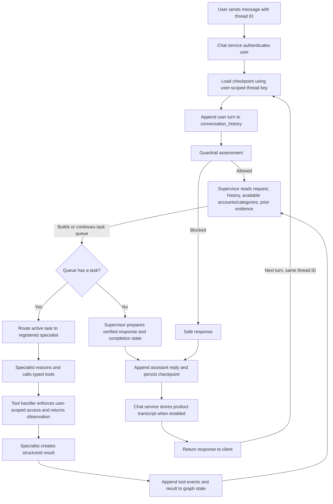

# A Battle I Faced: Making LangGraph Remember the Conversation

## Interview answer

One of the hardest problems I worked through in AffordAbled was making the AI chat behave like a continuing conversation rather than a collection of unrelated requests. The app already saved chat transcripts, and LangGraph already used a checkpoint for each user and thread, so at first glance it looked as if the assistant should remember what it had just done. In practice, follow-up questions such as “How much do I owe?”, followed by “Elaborate,” sometimes failed or triggered another tool call that did not have the right arguments.

I traced the problem through the graph instead of treating it as a prompt-only issue. I found that several different kinds of context were being confused: the product transcript, the graph's temporary working messages, structured specialist results, and tool observations. They have different jobs and different lifetimes. Once I separated those responsibilities and made the relevant information explicit in graph state, the supervisor and specialists could use verified earlier results to answer follow-ups reliably.

## What was failing

The failure was easiest to see with split questions:

1. I asked, “How much money do I owe to people?”
2. The split specialist called `get_split_summary` and returned a total.
3. I followed up with, “Elaborate.”
4. The follow-up could fail with a Pydantic validation error saying `arguments` was missing, or the assistant would say that the request was unclear.

There were two related issues behind this:

- **Tool invocation shape was not always what the tool schema expected.** The model or tool adapter could pass graph state as the tool input instead of the declared `arguments` object. That caused validation to fail before the split-summary handler ran.
- **The next turn did not have a dependable copy of the prior evidence.** New invocations reset the current `results`, and specialist handoffs clear working messages before creating a specialist's prompt. The application transcript was saved separately, but it was not automatically the same thing as prompt context for every graph node. A previous tool response could therefore exist in storage while being absent from the supervisor's current context.

This also explained why merely telling the LLM to “remember the conversation” was not enough. The graph needed to preserve and pass the right structured facts, and the tool boundary needed to validate its input consistently.

## How I fixed it

I treated conversation context as several explicit state components instead of one overloaded message list:

- **`messages`** is the active LangGraph working transcript. It can be cleared when handing off to a specialist so that the specialist receives a focused prompt.
- **`conversation_history`** is a separate, bounded record of recent user and assistant turns. It survives those handoffs and is supplied to the supervisor and specialists as context.
- **`results`** contains structured results for the current graph turn and can be reset when a new user turn begins.
- **`prior_results`** carries a bounded set of verified specialist results from the previous turn, so a short follow-up can be routed back to the relevant specialist.
- **`tool_event_history`** records tool observations across turns, including tool name, arguments, success/failure, returned data, specialist, task, and timestamp. The checkpoint retains a bounded history; prompts receive only a recent slice.

I also made tool arguments explicit in the observation contract. The tool runtime keeps the arguments passed to a handler; the LangChain tool-message adapter can recover them from the matching model tool call when necessary. This preserves both sides of an operation: what was asked of the tool and what the tool returned. The specialist result now carries those observations forward for the supervisor to reason over.

Finally, I updated the supervisor and analytics instructions to treat prior specialist results and tool observations as evidence for follow-ups. For example, “elaborate” after a split summary should use the verified participant-level details already returned. The assistant should request fresh data when the user asks for a current balance or updated total, but it should not needlessly repeat a read-only call just to explain an already retrieved result.

## Current LangGraph workflow

The workflow separates language understanding from execution and verification:

### What each layer is responsible for

| Layer | Responsibility |
|---|---|
| Chat API and service | Authenticate the caller, keep the application transcript, and pass the authenticated user and thread to the orchestrator. |
| LangGraph checkpointer | Resume a thread's graph state using a key scoped by both user ID and thread ID. |
| Guardrail | Decide whether the current request is within the assistant's allowed domain. |
| Supervisor | Interpret the request, plan/decompose tasks, choose a registered specialist, reconcile completed work, and decide whether to continue or finish. |
| Specialist runtime | Give a specialist a trusted handoff and its bounded context, execute its agent loop, and validate its result. |
| Tools and application services | Read or change finance data through explicit operations, with user identity and authorization enforced by the application. |
| Conversation and event state | Retain useful recent dialogue and structured tool evidence without relying on the specialist's temporary working messages. |

The LLM chooses among registered capabilities and interprets user language. Python and the application graph own routing, tool validation, queue progression, authorization boundaries, and state updates. Database-backed services remain authoritative for financial facts.

## Example: “Elaborate” after a split summary

When the user asks, “How much money do I owe to people?”, the split specialist can call `get_split_summary` with an empty arguments object because the tool's schema permits that general query. The result contains the verified total and outstanding split details. The runtime records the call arguments and observation, and the specialist returns a structured result.

On the next turn, the graph loads the same user-scoped thread checkpoint. It gives the supervisor the recent conversation, previous specialist result, and recent tool observations. The supervisor recognizes “elaborate” as a reference to the last answer and routes it to the appropriate specialist or response path. The specialist can explain the stored result without asking the user to restate the subject. If the user instead asks for a fresh total, the assistant can call the tool again.

## Why this design is safer and more reliable

- The specialist's working messages can be reset at handoff without erasing the conversation context needed by later nodes.
- The graph distinguishes a current-turn result from prior-turn evidence, reducing accidental reuse of stale facts as if they were current.
- Tool observations retain both arguments and results, which helps follow-up reasoning and makes traces easier to diagnose.
- User-scoped thread keys and authenticated tool context keep one user's conversation and financial data separate from another user's.
- The LLM can reason over context, but a claimed financial action or number still has to be supported by a tool observation or specialist result.
- History passed to prompts is bounded, while checkpoint state keeps a bounded event record, limiting prompt growth and checkpoint bloat.

## What I learned

The main lesson was that persistence alone does not equal usable context. Saving messages in a database or checkpoint is only one part of the job. Every node that needs information must receive it in a clear, structured form, and tool inputs and outputs must remain connected across the workflow. Separating the product transcript, recent conversational context, current task results, and tool events made it possible to reason about each failure precisely and fix the right layer.

## Implementation references

- [Graph state, thread checkpoint loading, supervisor routing, and chat orchestration](../apps/api/app/infrastructure/ai/agents/supervisor_graph.py)
- [Tool observation contracts](../apps/api/app/infrastructure/ai/agents/contracts.py)
- [Specialist runtime, tool-call argument capture, and persistent event updates](../apps/api/app/infrastructure/ai/agents/runtime.py)
- [Supervisor and analytics context instructions](../apps/api/app/infrastructure/ai/agents/prompts.py)

The implementation changes were checked with Ruff and Python compilation. The full automated test suite was not run for this change.
