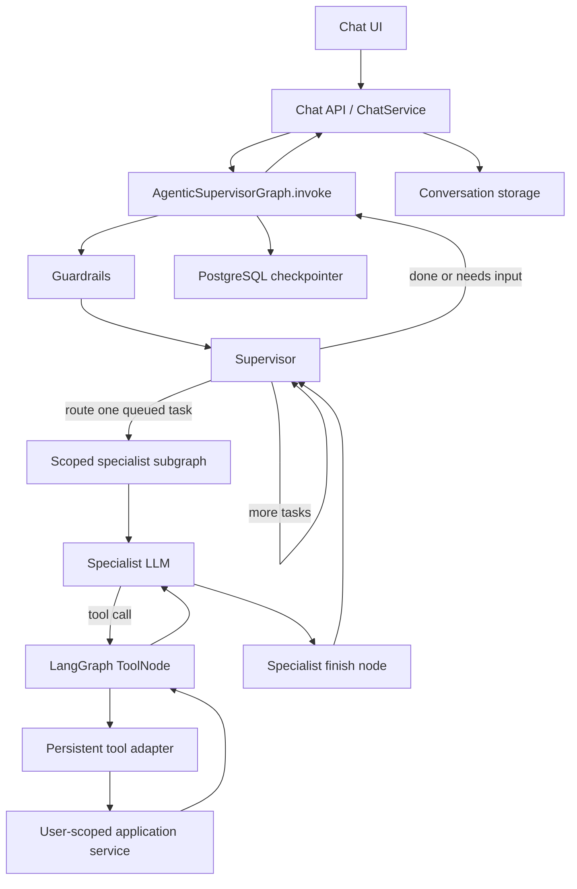

# LangGraph Integration Reliability Notes

This document records LangGraph integration failures encountered in AffordAbled, the architectural causes behind them, and the checks that should prevent similar regressions. It also records risks that remain important as the graph evolves.

## Application flow



The supervisor creates an ordered task queue and routes one active task at a time. Specialists have separate prompts and tool registries. A specialist result returns to the supervisor, which checks tool observations against the active task before consuming it. An interrupt pauses the graph and a later user reply resumes the same checkpointed thread.

## Incidents we encountered

| Symptom | Root cause | Guardrail in code or tests |
|---|---|---|
| `INVALID_CONCURRENT_GRAPH_UPDATE` on `conversation_history` | Multiple graph updates wrote the same state key, but it had no reducer. | `AgentGraphState.conversation_history` uses a bounded merge reducer. A regression test checks parallel and stale transcript snapshots. |
| A category clarification created a transaction but no memory evidence | The supervisor and specialist prompt had history, but the persistent tool adapter rebuilt `HandoffContext` without it. The transaction handler therefore could not see that the user was answering a category question. | `_persistent_tool_context` now forwards the latest 20 transcript entries to every specialist tool. Tests check the helper and the tool adapter. |
| `list_split_contacts` or `get_split_summary` failed Pydantic validation with a missing `arguments` field | A no-argument tool had an inferred schema that made the adapter's `arguments` wrapper required. LangGraph injected `state`, but the tool call had no `arguments` value. | No-argument and optional-argument tools have explicit schemas with defaults. Tests exercise state-only validation and an actual `ToolNode` call. |
| A specialist said work succeeded but the supervisor returned “could not verify” | The queue is reconciled from structured tool observations. A prose summary alone is not generally proof that a mutation happened. | Queue completion checks observed actions and the task's requested entity/type. Tests cover matching and non-matching observations. |
| An interrupt appeared in traces as `GraphInterrupt` | LangGraph implements `interrupt()` by bubbling a control-flow exception. Treating it as an ordinary tool failure or swallowing it would break pause/resume. | The tool runtime re-raises `GraphBubbleUp`; the root orchestrator reads `__interrupt__`, returns the question, and resumes with `Command(resume=...)`. |
| PostgreSQL chat failed with a missing LangGraph checkpoint column | An application-owned table had used a LangGraph table name, so LangGraph's setup ledger and physical schema diverged. | Migration `p1_separate_application_checkpoints` isolates the application table; app startup calls `AsyncPostgresSaver.setup()`. |
| Checkpointer startup failed due to URL/driver SSL differences | SQLAlchemy's asyncpg URL and LangGraph's psycopg connection use different driver and SSL parameter conventions. Unescaped reserved characters in passwords can also corrupt URL parsing. | `_normalize_langgraph_postgres_conn_string` converts the driver and SSL option for psycopg. Credentials must remain URL-encoded. Startup is bounded by a timeout. |
| Long transaction summaries failed `SpecialistResult` validation | The schema summary cap was lower than valid transaction output. | Specialist result summaries have a larger bounded limit; summaries are still bounded before entering graph state. |

## State and history rules

Graph state is persisted by thread. `messages` and `specialist_messages` use LangGraph's `add_messages` reducer. `conversation_history` is separate user-facing history, because specialist working messages are intentionally cleared when routing to a new specialist. Its custom reducer treats prefix snapshots as snapshots and bounds saved history to 100 entries.

Specialist prompts receive the active task, recent history, prior results, tool observations, user-scoped account/category/contact snapshots, and confirmed memories. Tool handlers receive a `HandoffContext` built from the same graph state. The shared adapter must not quietly omit new context fields when it constructs that object.

```python
history = (state.get("conversation_history") or [])[-20:]
context = HandoffContext(
    user_id=state["user_id"],
    request=active_task,
    history=history,
    constraints={"latest_user_reply": latest_reply, ...},
)
```

Keep the prompt window bounded, but preserve the active task separately from the latest user reply. A reply such as “Health” or “yes” is an answer to the pending task, not a replacement for it.

## Tool schema and state injection rules

Every tool exposed through `ToolBoundSpecialistRuntime` has a model-visible schema. `InjectedState` is runtime context and must not be modeled as a user argument. Tools with no required user input need a schema whose `arguments` field has a default; tools with optional filters need defaults for both the outer wrapper and optional fields.

```python
class EmptyArgumentsToolInput(BaseModel):
    arguments: dict[str, Any] = Field(default_factory=dict)

_TOOL_SCHEMAS = {
    "list_split_contacts": EmptyArgumentsToolInput,
    "get_split_summary": EmptyArgumentsToolInput,
}
```

When adding a tool:

1. Add it to exactly the intended specialist registry.
2. Add its input model to `_TOOL_SCHEMAS`, including an empty/defaulted model when it needs no arguments.
3. Give it a description explaining when to call it and what it returns or changes.
4. Test the exact model call shape through `ToolNode`, including injected state.
5. Confirm the handler uses the trusted context user ID and never accepts a caller-supplied user ID.

## Interrupt and resume rules

`interrupt()` is a graph pause, not a tool error. Let LangGraph's `GraphBubbleUp` propagate. The HTTP-facing orchestrator turns `__interrupt__` into the assistant question and resumes the checkpoint with `Command(resume=answer, update=...)`.

Resume code must preserve the original `task_request`, remaining `task_queue`, transcript, created transaction IDs, pending split transaction ID, and relevant tool observations. In receipt flows, the transaction is created first; an optional split is queued only after explicit user consent. A correction to a split must reuse the existing transaction ID and must not create the transaction again.

## Checkpoint and database rules

- Use a stable checkpoint thread key scoped as `user_id:chat_thread_id`; do not accept a global thread key without user ownership checks.
- Keep application tables out of names owned by LangGraph checkpointer tables.
- Run `AsyncPostgresSaver.setup()` for the deployed checkpointer and include checkpoint migrations in upgrade verification.
- Use PostgreSQL checkpointer mode in production so a DB outage cannot silently make chat state process-local. In-memory mode is for local tests/development only.
- Keep SQLAlchemy and checkpointer URL normalization explicit. Percent-encode reserved characters in credentials and never print the complete URL in logs.
- Test restart/resume against PostgreSQL, not only `InMemorySaver`, before depending on durable interrupts in a release.

## Concurrency, retries, and side effects

LangGraph can run multiple tool calls from one model response concurrently. The application currently shares an `AsyncSession` among specialist tools, so a shared `asyncio.Lock` serializes handler calls; failures roll back the session before retry. Preserve this constraint if tools are refactored or parallelized.

Retries around mutations need extra care. A handler can commit a side effect and then lose its response; retrying without idempotency can duplicate it. Keep database writes in a transaction where possible, use uniqueness/idempotency keys for externally retried mutations, and never automatically retry an operation after an ambiguous commit without checking whether it already happened.

Multiple simultaneous HTTP turns on the same chat thread are a separate concurrency case from ToolNode parallelism. If concurrent sends become supported, serialize them per user/thread or add a versioned compare-and-set strategy and test checkpoint conflicts.

## Security and ownership

The authenticated API supplies the user ID to the root graph. Specialists receive that trusted ID through `HandoffContext`; tools call user-scoped services/repositories. Model-generated arguments must never override that identity. The checkpointer key includes the authenticated user ID so one user's thread ID cannot load another user's state.

Review new tools for both read and write authorization. A correct prompt or tool description is not an authorization boundary; user scoping belongs in the application service/repository query.

## Audit performed

The graph and tool runtime were reviewed for:

- State keys written by multiple nodes and reducers on message/history channels.
- History flow from root state to supervisor prompt, specialist prompt, and every tool handler.
- Required versus optional tool argument schemas, including no-argument read tools.
- Interrupt propagation and resume context restoration.
- Task queue completion based on tool observations.
- Shared database session concurrency and rollback/retry behavior.
- User-scoped context, thread keys, and checkpointer startup/schema setup.

Current regression coverage includes `test_agent_runtime.py`, `test_agent_supervisor_graph.py`, `test_agentic_chat_api.py`, `test_itemized_splits.py`, `test_transaction_memory_capture.py`, and `test_shared_memory.py`. Focused LangGraph suite result at the time of this audit: **73 passed**; Ruff passed for the agents package and graph/runtime tests. The full API suite reported **144 passed and 4 failed**. All four failures were in `test_transaction_files.py` import-preview expectations (`valid_count` was 1 where the tests expected 2 or 3); they do not execute the LangGraph agent runtime and were not caused by the files changed in this audit. Track and resolve those import failures separately before treating the whole API suite as green.

## Release checklist for graph changes

- [ ] State channels with multiple writers have an intentional reducer.
- [ ] Conversation history reaches each specialist and every tool handler that may need it.
- [ ] Tool schemas match actual call shapes, including empty input and injected state.
- [ ] Interrupts pause and resume without losing the active task or repeating completed writes.
- [ ] Queue items are consumed only by verified observations or an explicit, tested recovery rule.
- [ ] Parallel tool calls cannot share an unsafe DB session concurrently.
- [ ] Mutation retries are safe under ambiguous completion.
- [ ] Checkpointer schema is initialized and durable in the target environment.
- [ ] User ID comes from authentication and scopes all tool/service access and checkpoint keys.
- [ ] Tests cover both isolated helper logic and at least one end-to-end graph/tool-node path.
