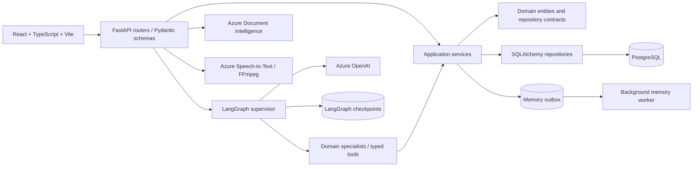
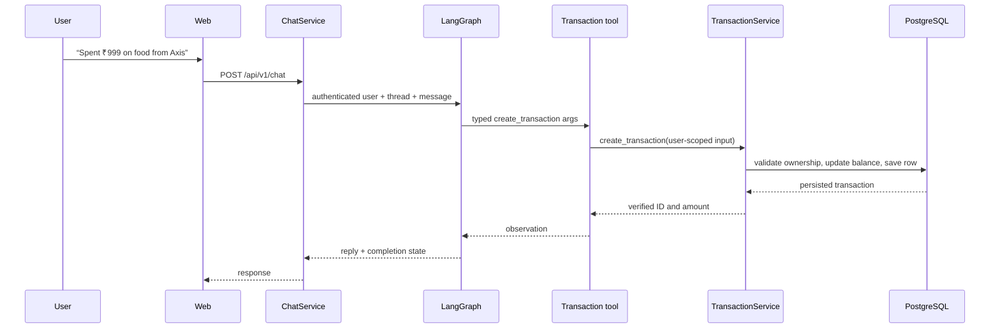

# AffordAbled: product, architecture, and resume guide

This document explains the application as it exists in the repository on 22 October 2026. It is written for a portfolio, resume, demo, or technical interview. It describes code and design; it does **not** claim production availability, a measured performance improvement, or a user count. The group settlement planner is present as **uncommitted work in the current workspace** and needs migration and release verification before it can be described as deployed.

## 1. What AffordAbled is

AffordAbled is a personal finance web application with a conventional wallet interface and an AI assistant. A user can create accounts, categorize income and expenses, inspect spending, import or export transactions, and track money shared with other people. The assistant lets the user express those tasks in ordinary language, by voice, or through a receipt image. The application keeps the financial records and calculations in typed backend services; the language model interprets requests and selects tools.

**One sentence for a resume:** Built a full-stack personal finance application that combines an auditable transaction ledger, conversational workflows, receipt and voice input, shared-expense tracking, and user-reviewed preference memory.

### Problem it addresses

Personal finance data often starts as a receipt, bank export, spoken note, or loosely phrased chat message. Recording it manually is repetitive. Shared bills add another layer: who consumed an item, who paid, who owes whom, and whether a later repayment should change the wallet balance. AffordAbled puts these paths in one app while making the backend validate money amounts and ownership before records are saved.

### What it improves

| User or engineering problem | AffordAbled approach | Practical benefit |
|---|---|---|
| Re-entering expenses from different sources | Manual form, chat, receipt OCR, voice transcription, and file import share the transaction service | Multiple input paths lead to the same ledger rules |
| Conversational instructions are ambiguous | The graph can ask for missing account, category, amount, participant, or receipt details | The app can pause before an uncertain action |
| LLM arithmetic and unsupported claims | Typed tools pass facts to deterministic application services; completion is checked against tool observations | Calculations and success messages can be tied to recorded results |
| Shared bills mix consumption, payments, and old debts | Split calculators keep expense shares and settlement transfers distinct | The app can show what each person consumed and what remains to be paid |
| Repeated category or person preferences are easy to lose | Review events and a durable outbox build suggestions that the user must confirm | Reusable preferences can be learned without silently changing future records |
| Imported files may contain bad rows | Preview, validation, and confirmation precede commit | The user can correct errors before balances change |

These are design benefits, not measured reductions in time, errors, or cost. Add numerical impact only after collecting evidence.

## 2. What has been built

### Core wallet

- Account management for bank, cash, card, and wallet accounts, including an initial balance, active status, and a default account.
- User-owned expense and income categories. Registration seeds starter categories; users can manage their own later.
- Expense, income, refund, and transfer transactions with account balance effects, category-type checks, editing, soft deletion, and restoration.
- A dashboard, account page, transaction page, profile page, and mobile layouts in the React app.
- Email/password authentication, optional Google login integration, short-lived access tokens, and refresh sessions. The browser keeps the access token in memory and attempts a cookie-based refresh at startup.

### Conversational assistant

- A LangGraph supervisor routes work to focused specialists for transactions, accounts, categories, analytics, splits, and exports.
- Multi-step requests can be queued: for example, create an account, create a category, then record an expense. The transaction specialist does not need to write its own account or category logic.
- Typed tool schemas and server-side handlers keep the model's actions within permitted capabilities.
- A user-scoped thread and a PostgreSQL LangGraph checkpointer preserve the working conversation state when configured. The product chat transcript is persisted separately when conversation storage is enabled.
- Follow-up turns carry bounded conversation history, prior specialist results, tool observations, and verified transaction IDs. A split can therefore refer to the actual transaction just saved.
- An assistant response exposes task completion and a created transaction ID for the UI completion flow. Errors and uncertain cases can lead to clarification or a manual transaction fallback.

### Other input and output paths

- Receipt images are validated and passed to Azure Document Intelligence OCR. The extracted text is labeled untrusted. The prompt tells the agent to record **one transaction for the final total**, not a transaction for every receipt line. A split requires a later, explicit user choice.
- Voice uploads are validated for format and size; FFmpeg converts supported compressed audio to WAV when needed, then Azure Speech-to-Text produces text for the chat workflow.
- CSV/XLSX transaction import supports preview and confirmation with account/category resolution and row validation.
- CSV/XLSX/PDF report export supports downloads and chat-driven report requests.

### Sharing expenses and tracking repayment

- Equal and custom splits attach to an expense. The owner has a separate share; external participants are stored as named people.
- Itemized splits can allocate priced rows to the people who shared them and require review before saving.
- Quantity-based splits calculate named people's fixed items and divide the remaining bill across everyone, including the owner. Contributions and directed debts feed a separate net settlement plan.
- A standalone “someone owes me” entry can exist without a wallet transaction. Repayment flows link an actual owner payment to an income transaction rather than merely changing display text.
- Split contacts and explicit preferences can help resolve names, while the request itself determines who participates.

### User-controlled preference memory

- Transaction review or editing, split review, and flagged chat clarifications can create evidence events.
- The event and its outbox row are persisted so a background worker can process it outside the interactive request.
- The chat analysis worker uses a bounded history and a typed memory signal. It verifies candidate evidence against user messages and owned accounts/categories before producing a normal review event.
- A pattern needs **three distinct review events** to become a visible suggestion. The user can confirm, edit, dismiss, or delete a memory; only confirmed memories are supplied to relevant specialist context.

### Current workspace work: complex group settlements

The current branch contains uncommitted files for a group settlement planner. Its draft model represents multiple bills with charges, coupons, percentage fees or tips, actual payers, and directed existing debts. A deterministic calculator allocates each charge in integer paise, applies discounts and fees, checks that payments equal each calculated bill total, and nets balances into proposed transfers. The planner can preview a draft before wallet expenses are created; confirmation is the intended write boundary. Per-row `paid_by` fields are also present in the current code. This feature has an Alembic migration and API/frontend work in the workspace, but **do not claim it is released until the migration, focused tests, UI flow, and deployment are verified**.

## 3. Architecture



### Frontend

The web app uses React, TypeScript, Vite, React Router, Redux Toolkit with RTK Query, Tailwind CSS, React Hook Form, and Zod. Routing separates a public landing and auth flow from protected pages. Feature API modules keep network operations near their domain (`features/transactions`, `features/splits`, `features/chat`, and others). Reusable UI elements include transaction forms, a mobile bottom sheet, a voice capture modal, and a memory suggestion panel.

Relevant code: [`apps/web/src/app/router.tsx`](../apps/web/src/app/router.tsx), [`apps/web/src/lib/apiClient.ts`](../apps/web/src/lib/apiClient.ts), [`apps/web/src/pages/ChatPage/ChatPage.tsx`](../apps/web/src/pages/ChatPage/ChatPage.tsx), [`apps/web/src/pages/SplitsPage/SplitsPage.tsx`](../apps/web/src/pages/SplitsPage/SplitsPage.tsx).

### Backend layers

| Layer | Responsibility | Examples |
|---|---|---|
| Presentation | Authenticated HTTP routes and request/response schemas | `presentation/routers`, `presentation/schemas` |
| Application | Transaction, split, import/export, memory, and settlement workflows | `application/services` |
| Domain | Entities, exceptions, ports, and repository interfaces | `domain/entities`, `domain/ports.py`, `domain/repositories.py` |
| Infrastructure | Database adapters, AI runtime, Azure clients, audio, files, jobs | `infrastructure/database`, `infrastructure/ai`, `infrastructure/jobs` |

This separation makes a key claim defensible: the LLM is an interface to finance operations, while the application services are the source of financial rules. Routers do not need to repeat account-balance or split arithmetic. Tool handlers call the same service boundary used by ordinary API flows.

### Database and migration strategy

PostgreSQL stores users, refresh sessions, accounts, categories, transactions, chat records, splits, memory records, exports/imports, and the new settlement models in the current workspace. SQLAlchemy repositories keep queries user-scoped. Alembic revisions record schema changes. LangGraph uses a PostgreSQL checkpoint saver in normal configured operation; an in-memory saver is available for development/fallback, with the limitation that those checkpoints are not durable. The memory worker's outbox rows and retry state also live in the database.

Relevant code: [`apps/api/app/main.py`](../apps/api/app/main.py), [`apps/api/app/infrastructure/database/session.py`](../apps/api/app/infrastructure/database/session.py), [`apps/api/alembic/versions`](../apps/api/alembic/versions).

## 4. How a chat operation works

Example request: **“Spent ₹999 on food from Axis.”**

1. The React client submits an authenticated chat message and thread ID to `/api/v1/chat`.
2. `ChatService` calls the orchestration port with the authenticated user ID, message, thread, and timezone.
3. The graph runs a semantic guardrail and loads bounded context, user-owned accounts/categories, confirmed memories, and relevant prior observations.
4. The supervisor chooses the active task and routes it to the transaction specialist. If an account or category is missing, a specialist asks for details or creates it through its scoped tool.
5. The specialist calls a typed tool. `TransactionService` validates the account, transaction type, positive amount, and category ownership; it applies the balance effect and persists the transaction.
6. The tool returns the saved transaction's ID and amount. The graph uses that observation when it builds the final response and completion state.
7. `ChatService` stores the user and assistant messages in the product transcript when conversation storage is enabled and links a created transaction to its chat thread.
8. The UI can show a completion review or navigate to the saved transaction. A follow-up such as “split that with A and B” uses the saved transaction ID.



The model may misunderstand a request, and providers may fail. The boundary above limits the impact of that uncertainty; it does not guarantee every chat turn succeeds. A sensible demo should include a clarification turn and an error fallback, not only a perfect single-turn example.

### Why LangGraph is used

LangGraph gives the application explicit nodes and state transitions for routing, specialist tools, follow-up questions, and resumable turns. The supervisor can decompose a request such as “create Axis with ₹6,000, then log ₹999 on food” into ordered operations. Specialists have restricted tool lists. The code stores prior structured results and observations so a later “yes” or “that transaction” can refer to the right object. The graph has limits on routing and tool iteration; a checkpointer persists state when PostgreSQL is configured.

Relevant code: [`apps/api/app/infrastructure/ai/agents/supervisor_graph.py`](../apps/api/app/infrastructure/ai/agents/supervisor_graph.py), [`apps/api/app/infrastructure/ai/agents/runtime.py`](../apps/api/app/infrastructure/ai/agents/runtime.py), [`apps/api/app/infrastructure/ai/agents/contracts.py`](../apps/api/app/infrastructure/ai/agents/contracts.py), [`apps/api/app/application/services/chat_service.py`](../apps/api/app/application/services/chat_service.py).

## 5. Financial correctness and review boundaries

### Integer minor units

The ledger and split calculators use `amount_paise` as an integer. A value displayed as ₹97,547.88 is calculated as `9_754_788` paise. This avoids binary floating-point drift and makes reconciliation exact. Percentage calculations in the complex settlement planner use basis points and `Decimal` rounding. For example, 2% is `rate_bps=200`; 2% of a ₹1,800 fare becomes ₹36, not ₹200.

### Split shares versus settlement transfers

Expense share answers **“How much of the bill belongs to each person?”** A settlement transfer answers **“Who must pay whom after accounting for prior payments and debts?”** The current calculators keep those as different values:

```text
person's net balance = amount already paid - allocated expense share
existing debt: subtract from debtor, add to creditor
match negative balances to positive balances in integer paise
```

For a ₹1,000 expense shared equally by You and A and paid entirely by You, each share is ₹500. A owes You ₹500; Your expense share remains ₹500. If A had already paid ₹200 toward the same bill, only ₹300 remains due. An unrelated old debt can change the final transfer without changing either person's consumption share. The calculators check that the sum of shares equals the bill and that net balances sum to zero.

### AI extraction versus calculation

For a complicated request, the model's useful job is to identify structured facts: bill lines, who shared them, percentages, payers, and any old debts. Application code then validates those facts and calculates. The group settlement draft rejects unknown charge references, ambiguous percentage bases, mismatched totals, and payment sums that do not reconcile. This is the central architectural lesson from the project: **natural language interpretation is probabilistic; money arithmetic and persistence need deterministic rules**.

Relevant code: [`apps/api/app/application/services/quantity_split.py`](../apps/api/app/application/services/quantity_split.py), [`apps/api/app/application/services/settlement_split.py`](../apps/api/app/application/services/settlement_split.py), [`apps/api/app/application/services/complex_settlement.py`](../apps/api/app/application/services/complex_settlement.py) (current workspace work).

## 6. Preference memory and background processing

Example: the assistant asks which category to use for “ibu”; the user chooses Medicine. After the transaction is recorded, the bounded clarification context may be queued for background analysis. The analyst can propose an “ibu → Medicine” candidate only when the user's message supports it and Medicine is an owned category. Each reviewed occurrence contributes a distinct evidence event. After three matching events, the app can show a suggestion; confirmed preferences can inform future specialist context.


The outbox provides durable retry state and keeps optional analysis out of the transaction's interactive path. Duplicate event fingerprints avoid counting identical retries as new evidence. This is an **in-process polling worker**, not a separate queue cluster; the API process must run, the feature must be enabled, and its database and optional analysis model must be configured. A pattern can exist as pending evidence before it becomes a visible suggestion.

Relevant code: [`apps/api/app/infrastructure/database/repositories/sqlalchemy_memory_repository.py`](../apps/api/app/infrastructure/database/repositories/sqlalchemy_memory_repository.py), [`apps/api/app/infrastructure/jobs/memory_jobs.py`](../apps/api/app/infrastructure/jobs/memory_jobs.py), [`apps/api/app/infrastructure/ai/agents/chat_memory_analysis.py`](../apps/api/app/infrastructure/ai/agents/chat_memory_analysis.py).

## 7. Security, privacy, and operational choices

- **Identity scope:** The API derives the user from authentication. Services and repositories fetch accounts, categories, transactions, splits, and memories for that user instead of trusting an LLM-provided user ID.
- **Session design:** Access tokens live in frontend memory. Refresh tokens use an HTTP-only cookie scoped to auth endpoints, with production cross-site settings for the Azure UI/API domains. Browser cookie policy can still affect refresh behavior, so this should be verified on the target devices.
- **Cross-origin requests:** Allowed origins are configurable; production UI origins must be explicitly configured. CORS controls browser access to responses and is not a substitute for request authorization.
- **Untrusted OCR:** Extracted receipt text is treated as data rather than instructions with authority over the backend.
- **Bounded input and history:** Image/audio size and type limits, bounded history, bounded specialist iterations, and bounded error messages reduce accidental overload and leakage.
- **Observability:** Structured logging, request IDs, health checks, optional LangSmith tracing, and a startup FFmpeg probe help diagnose provider and deployment faults.
- **Retention:** Optional cleanup jobs can remove older chat messages according to configuration. Conversation storage is a per-user setting.

Relevant code: [`apps/api/app/presentation/routers/auth_router.py`](../apps/api/app/presentation/routers/auth_router.py), [`apps/api/app/core/middleware.py`](../apps/api/app/core/middleware.py), [`apps/api/app/application/services/image_service.py`](../apps/api/app/application/services/image_service.py), [`apps/api/app/main.py`](../apps/api/app/main.py).

## 8. Technology and repository map

| Area | Technologies and implementation |
|---|---|
| Web | React, TypeScript, Vite, React Router, Redux Toolkit/RTK Query, Tailwind CSS, React Hook Form, Zod |
| API | Python 3.13, FastAPI, Pydantic, async SQLAlchemy |
| Database | PostgreSQL, Alembic; SQLite is used by some lightweight tests |
| AI | LangGraph, LangChain tool calling, Azure OpenAI, optional LangSmith traces, NeMo guardrails |
| Media and files | Azure Document Intelligence, Azure Speech-to-Text, FFmpeg, CSV/XLSX/PDF tooling |
| Verification | pytest, pytest-asyncio, Ruff, TypeScript compiler, ESLint, Vite build |
| Infrastructure | Docker Compose for local services, Azure App Service API workflow; web app can be built for Azure Static Web Apps |

| Directory | What to explain in an interview |
|---|---|
| [`apps/api/app/presentation`](../apps/api/app/presentation) | HTTP boundary and API contracts |
| [`apps/api/app/application/services`](../apps/api/app/application/services) | Deterministic business workflows |
| [`apps/api/app/domain`](../apps/api/app/domain) | Finance entities and contracts |
| [`apps/api/app/infrastructure/ai/agents`](../apps/api/app/infrastructure/ai/agents) | Supervisor, specialists, tool runtime |
| [`apps/api/app/infrastructure/database`](../apps/api/app/infrastructure/database) | Models, sessions, user-scoped repositories |
| [`apps/api/tests`](../apps/api/tests) | Backend regression tests |
| [`apps/web/src/pages`](../apps/web/src/pages) | User flows and responsive pages |
| [`apps/web/src/features`](../apps/web/src/features) | Typed frontend API modules |
| [`infra`](../infra) | Local service configuration |

## 9. What to say on a resume

Use only bullets for work you personally owned. These describe the repository without making unsupported performance or deployment claims.

### Compact project entry

**AffordAbled | Personal AI Wallet** — React, TypeScript, FastAPI, PostgreSQL, LangGraph, Azure AI

- Built a full-stack finance app for user-scoped accounts, categories, transactions, shared expenses, and CSV/XLSX/PDF transaction workflows.
- Designed a LangGraph supervisor with domain-specific agents and typed tools, allowing multi-turn financial tasks while validating writes through application services.
- Implemented deterministic integer-paise split and settlement calculations that separate item consumption, actual payments, and directed debts.
- Added receipt OCR, voice transcription, and a durable, user-confirmed preference-memory workflow using database outboxes and background processing.

If the complex planner is tested and released, add: **“Built a reviewable multi-bill settlement planner with item-level allocations, percentage discounts/fees, multiple payers, and exact net transfers.”** Until then, describe it as an implementation in progress during an interview or portfolio walkthrough.

### Thirty-second interview explanation

> AffordAbled is a wallet app with an AI interface. The user can record transactions manually or through chat, receipts, and voice, then manage splits and reports. I used LangGraph to route natural-language requests to restricted finance tools. The backend validates ownership and uses integer paise for the actual accounting, so the model interprets a request but cannot be the source of truth for balances or settlement math. I also built a database-backed memory workflow that waits for repeated reviewed evidence and user confirmation before reusing a preference.

### One technical story to expand

**Challenge:** An agent could propose a plausible split whose numbers or follow-up context were wrong. **Design response:** Keep verified transaction IDs and tool observations in graph state; pass typed extraction to finance services; calculate shares and transfers in integer paise; require reconciliation and review before persistence. **What to show:** the graph handoff, a split calculator, and a test where item quantities plus shared remainder equal the recorded total. **Do not claim:** a measured hallucination reduction without evaluation data.

### Metrics to collect before adding quantified bullets

- Median and 95th-percentile chat latency by graph step; number of Azure OpenAI calls per turn.
- Rate of successful tool calls, clarification turns, corrections, and transaction retries.
- Share of imported rows accepted after preview; time to complete common manual versus chat flows.
- Outbox backlog, retry rate, and time from the third evidence event to suggestion display.
- Accuracy on a fixed split/settlement scenario set, including refunds, partial payments, discounts, and old debts.

## 10. Demo scenarios and honest limits

1. **Wallet:** register, create an account, record a manual expense, and inspect the changed balance.
2. **Multi-step chat:** create an account and category, then record one expense; show the saved transaction ID and a follow-up query.
3. **Receipt:** upload a receipt, confirm its grand total, log exactly one expense, then choose whether to split it.
4. **Split:** allocate a fixed item to one person, divide the remainder, and compare expense shares with who owes whom.
5. **Memory:** repeat a reviewed merchant/category choice enough times for a suggestion, then confirm or dismiss it.
6. **Files:** preview an invalid import, correct it, confirm the import, and export a filtered report.
7. **Complex settlement (current workspace):** preview multiple bills with a coupon, a percentage fee, different payers, and an old debt; inspect reconciliation before confirming. Run the migration and focused tests first.

Operational limits to state plainly: Azure OCR, speech, and model features need configured credentials; FFmpeg must be available for compressed audio; PostgreSQL is needed for normal persistence and durable graph checkpoints; the in-process memory worker runs only while the API is running; browser refresh sessions depend on cookie behavior; and current workspace settlement changes are not automatically part of a deployed build.

## Further reading

- [Project and resume reference](AFFORDABLED_PROJECT_REFERENCE.md)
- [Detailed LangGraph architecture](LANGGRAPH_ARCHITECTURE_GUIDE.md)
- [LangGraph reliability notes](LANGGRAPH_INTEGRATION_RELIABILITY.md)
- [Transaction import/export](TRANSACTION_FILES.md)
- [Complex settlement usage](COMPLEX_SETTLEMENTS.md)
- [Release checklist](V1_RELEASE_CHECKLIST.md)
